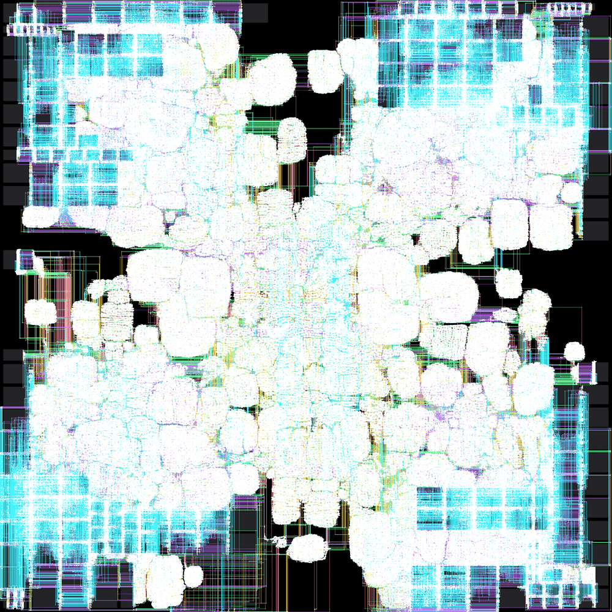
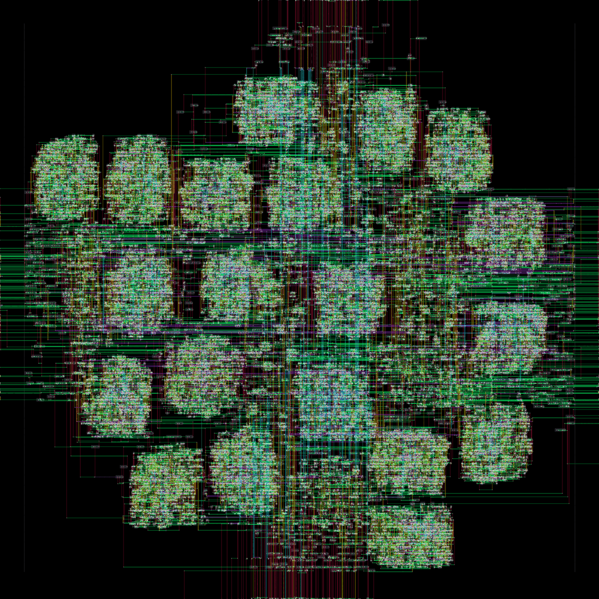
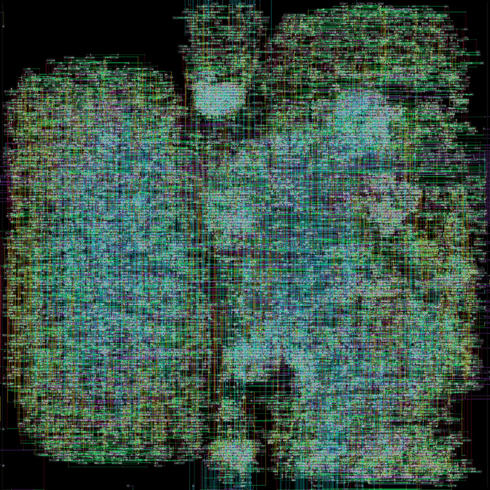
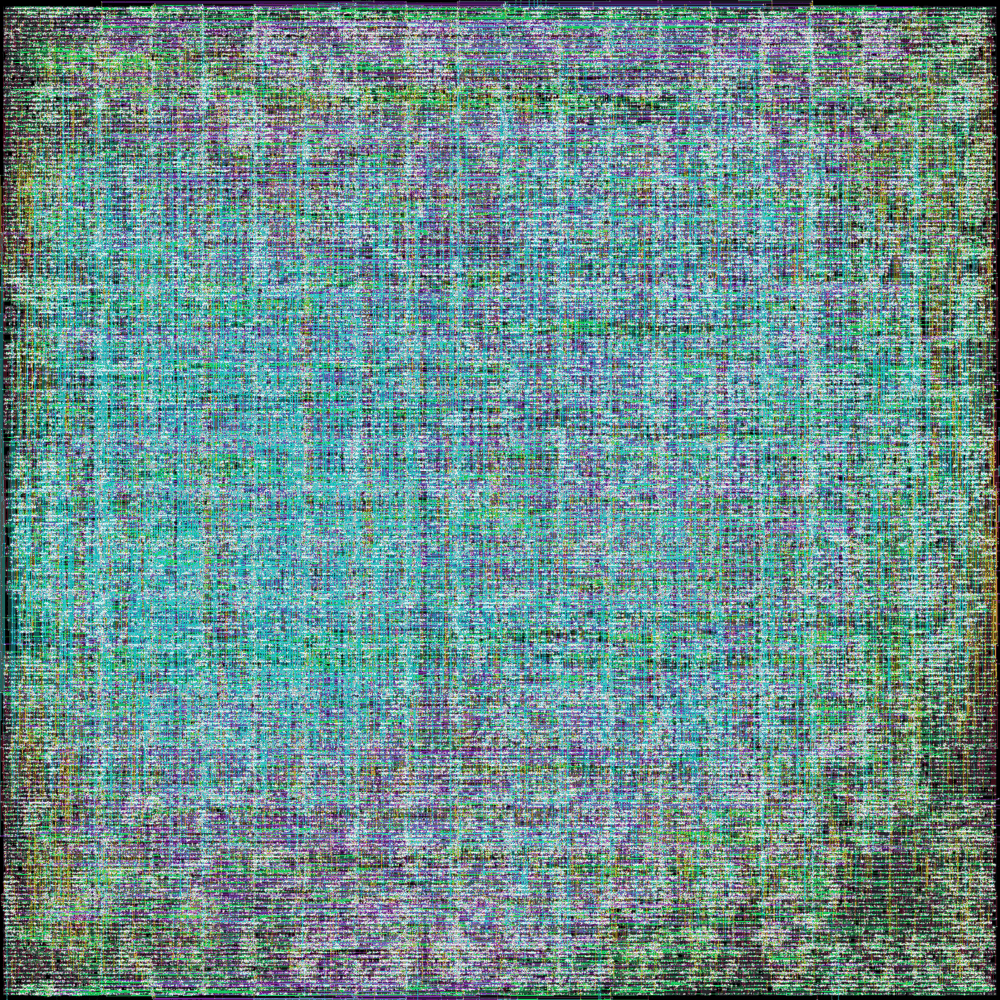
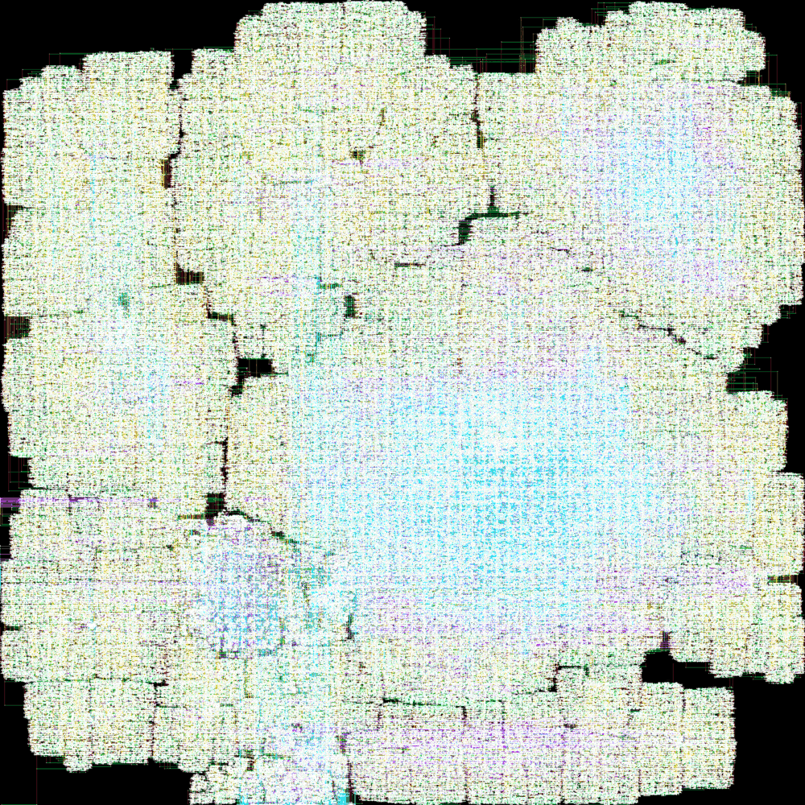
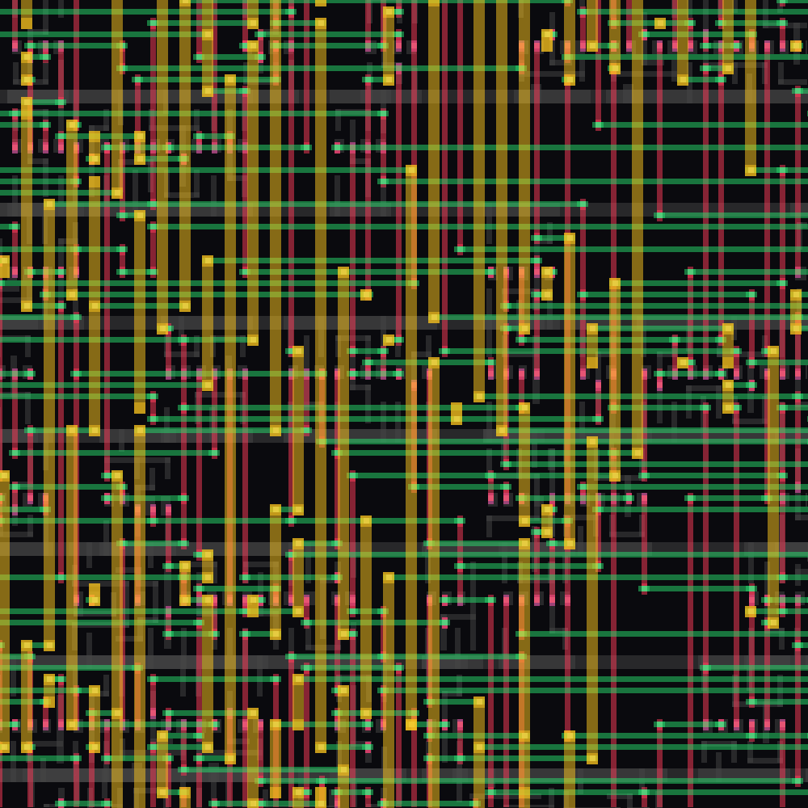

# PARE — Placement And Routing Engine

[](https://github.com/willmccallion/vlsi-physical-design/actions/workflows/ci.yml)

A digital IC placement and routing engine written in Rust, built from scratch. It reads LEF/DEF and Bookshelf, places cells by electrostatic spreading, legalizes and refines the placement, routes every net globally and then on the design's tracks, and checks the result against the technology's design rules with a checker modelled on OpenROAD's.

**Status:** PARE has placed and routed nine Nangate45 designs, from gcd (563 nets) to bp_quad, a BlackParrot quad-core chip of 1.24 million cells and 1.24 million nets, with zero design rule violations, judged both by its own checker and by OpenROAD's `check_drc` with a fix for one of its bugs applied (see below). Routing the same placements, OpenROAD's own router uses 3 to 5% less wire and PARE is 4 to 8 times faster (see PARE versus OpenROAD). From the same floorplans, PARE's whole flow, with timing-driven placement, clock tree synthesis that builds OpenROAD's trees exactly, setup and hold repair, and repair again on the parasitics of the global routes, ends within 0.03 ns of OpenROAD-flow-scripts' worst slack on aes, ibex and jpeg and ahead of it on ariane133, with propagated clocks, in a quarter to two fifths of the time (see Whole flows). No ISPD 2015 design is clean yet.

## Results

Each design is placed from its floorplan and then routed by `pare run <design>`, except gcd, whose placement is part of the input. aes, ibex and jpeg are synthesized and floorplanned by OpenROAD-flow-scripts 26Q2, as its Nangate45 flow does them, at 32%, 50% and 81% utilization; swerv, netcard and leon3mp come from OpenROAD's placer tests, at 10%, 60% and 59%. ariane133, with 132 fakeram45 SRAM macros, and bp_quad, with 220 on a 3.6 × 3.6 mm die, are synthesized and floorplanned by OpenROAD-flow-scripts 26Q2 too, at 32% and 22%. The four synthesized designs run with the netlist repair and timing work of the Netlist repair and timing section, so their cell counts include the buffers it adds and leave out the ones it removes. Nets counts the signal nets with two or more pins, the ones there are to route; wirelength is the length of all their routed wires along the centreline. Routed DEFs are checked by OpenROAD 26Q2 `check_drc`.

| Design | Cells | Nets | Wirelength | Vias | PARE violations | OpenROAD `check_drc` | Time | Peak memory |
|---|---:|---:|---:|---:|---:|---:|---:|---:|
| gcd | 676 | 563 | 7.5 mm | 3,934 | 0 | 0 | 0.8 s | 0.5 GiB |
| aes | 16,808 | 16,577 | 269 mm | 175,868 | 0 | 0 | 45 s | 2.1 GiB |
| ibex | 17,286 | 18,417 | 315 mm | 183,591 | 0 | 0 | 51 s | 2.3 GiB |
| jpeg | 66,423 | 73,299 | 609 mm | 539,463 | 0 | 0 | 2 min 7 s | 4.2 GiB |
| swerv | 135,119 | 130,357 | 5,422 mm | 1,520,105 | 0 | 0 | 4 min 50 s | 4.7 GiB |
| ariane133 | 180,692 | 181,399 | 6,356 mm | 2,048,143 | 0 | 0 | 12 min 49 s | 6.5 GiB |
| netcard | 274,700 | 290,334 | 10,647 mm | 3,538,026 | 0 | 0 | 1 h 7 min 37 s | 9.3 GiB |
| leon3mp | 312,529 | 406,912 | 8,522 mm | 4,214,878 | 0 | 0 | 18 min 28 s | 9.1 GiB |
| bp_quad | 1,241,520 | 1,244,956 | 52,411 mm | 13,885,998 | 0 | 0 | 1 h 10 min 46 s | 23.1 GiB |

Measured on an Intel Core i7-14700K (28 threads) with 64 GB of memory: aes, ibex, jpeg and ariane133 at commit `2457308`, with netlist repair, timing-driven placement, clock trees and repair on the global routes, and the rest at `dc60d69`, before either. Time and memory cover the whole run, netlist repair and placement included.

OpenROAD's `check_drc` has a bug that reports spacing violations between two vias of one net where its wire fills the gap ([#11697](https://github.com/The-OpenROAD-Project/OpenROAD/issues/11697)). The counts above come from OpenROAD with the proposed fix ([#11698](https://github.com/The-OpenROAD-Project/OpenROAD/pull/11698)) applied, which `nix develop .#eda` builds. Unpatched OpenROAD reports 0 on gcd, aes, ibex and jpeg, 4 on swerv, 1 on ariane133, 3 on netcard, 1 on leon3mp and 4 on bp_quad, all spacing markers within one net like those; [docs/openroad-check-drc-tiling.md](docs/openroad-check-drc-tiling.md) has the evidence.

<p align="center"></p>
<p align="center">bp_quad: 1.24 million cells and 220 SRAM macros on a 3.6 × 3.6 mm die, routed.</p>

<table>
  <tr>
    <td></td>
    <td></td>
  </tr>
  <tr>
    <td align="center">aes</td>
    <td align="center">ibex</td>
  </tr>
  <tr>
    <td></td>
    <td></td>
  </tr>
  <tr>
    <td align="center">jpeg</td>
    <td align="center">leon3mp</td>
  </tr>
</table>

At 32% utilization, aes's cells pack to a target density of 0.47 and gather into islands, as they do in OpenROAD's own placement of the same floorplan. Below, 10 × 10 µm of routed aes on metal1 to metal4, drawn at its true geometry by `pare view`:

<p align="center"></p>

---

## PARE versus OpenROAD

The fairest test of a router is another router on the same placement. `scripts/compare.py` routes each design's PARE placement twice: with PARE, and with OpenROAD 26Q2's global and detailed router set up as OpenROAD-flow-scripts sets them up for Nangate45, with its layer adjustments, routing layers, iteration counts and thread count, but without the repairs its flow runs between the two, which would change the netlist. Each result is checked by OpenROAD's `check_drc` and by PARE's checker, then timed by OpenROAD's timer with parasitics extracted from the routed wires, against the flow's clock constraint for the design. The netlists are the floorplanned ones straight out of synthesis, with no buffering, resizing or clock tree, so both routings miss their clocks by a wide margin; the slacks compare two routings of one netlist, not the designs.

| Design | Router | Wirelength | Vias | PARE violations | OpenROAD `check_drc` | WNS | TNS | Time | Peak memory |
|---|---|---:|---:|---:|---:|---:|---:|---:|---:|
| aes | PARE | 227.2 mm | 150,724 | 0 | 0 | -2.19 ns | -395.7 ns | 17 s | 1.9 GiB |
| aes | OpenROAD | 216.7 mm | 115,220 | 0 | 0 | -2.46 ns | -311.8 ns | 1 min 57 s | 2.5 GiB |
| ibex | PARE | 374.9 mm | 188,822 | 0 | 0 | -0.82 ns | -679.1 ns | 14 s | 2.1 GiB |
| ibex | OpenROAD | 358.6 mm | 136,148 | 0 | 0 | -0.73 ns | -565.6 ns | 1 min 17 s | 2.8 GiB |
| jpeg | PARE | 1,036.4 mm | 578,571 | 0 | 0 | -1.24 ns | -691.9 ns | 50 s | 3.9 GiB |
| jpeg | OpenROAD | 980.5 mm | 389,779 | 0 | 0 | -1.15 ns | -620.7 ns | 3 min 31 s | 4.4 GiB |
| ariane133 | PARE | 7,504.2 mm | 2,109,089 | 0 | 0 | -1.20 ns | -2,593.2 ns | 10 min 2 s | 6.4 GiB |
| ariane133 | OpenROAD | 7,271.7 mm | 1,422,559 | 0 | 0 | -1.24 ns | -2,760.2 ns | 48 min 13 s | 11.8 GiB |

PARE at commit `06cc695`, ibex at `6370079`, on the machine above; time and memory are the router's alone. WNS and TNS are the worst and total negative slack of the paths the clock constrains, with ideal clocks.

Both routers leave every design clean by both checkers. OpenROAD uses 3 to 5% less wire and 24 to 33% fewer vias; PARE is 4 to 7 times faster and uses less memory. On the clocked paths neither is ahead throughout: PARE's worst slack is the better one on aes and ariane133 and OpenROAD's on ibex and jpeg, by 3 to 11%, and OpenROAD's total negative slack is the lower one on three of the four. Most of the via gap is wrong-way wiring: per design, OpenROAD routes 19,170 to 244,603 segments against their layer's direction, where PARE routes none and pays two vias for each jog instead.

On ibex and ariane133 the worst path of both routings is not a clocked path but the reset: `rst_ni` is an input port that drives 1,664 and 20,618 flops directly, because nothing has buffered it, and its recovery checks fail by the wire delay of that one net. That net is where the two routers differ most. PARE routes ariane133's in 109,501 µm and 64,970 vias against OpenROAD's 94,684 µm and 49,015 vias, both almost entirely on metal2 and metal3, and the Elmore delay to its farthest flop is 703 ns against 512 ns (`scripts/net_report.py`); on ibex, 9.6 ns against 7.0 ns. The timer does not report so large a net consistently, 118 ns through PARE's route of it and no delay at all through OpenROAD's, so the table leaves the recovery checks out; `compare.py` reports every path group.

### Whole flows

`scripts/compare.py --flow` starts both tools from the same floorplan. PARE runs as `pare run` does: it removes the buffers synthesis inserted, buffers the ports, places timing-driven, repairs slews and loads, legalizes, builds the clock trees, repairs the setup and hold paths, routes globally, repairs slews, loads, setup and hold again on the global routes' parasitics and routes in detail. OpenROAD-flow-scripts runs its own stages as its Makefile orders them: the same buffer removal and port buffering, I/O pin placement after a first global placement, timing- and routability-driven placement, `repair_design`, legalization, clock tree synthesis with `repair_timing`, global routing with `repair_design` and `repair_timing` on its parasitics and antenna repair, and detailed routing. Both results are timed by OpenSTA with parasitics extracted from the routed wires and the clocks propagated through each flow's clock trees; slew and capacitance violations are its counts on the same parasitics.

| Design | Tool | Cells | Wirelength | Vias | PARE violations | OpenROAD `check_drc` | Slew / cap violations | WNS | TNS | Time | Peak memory |
|---|---|---:|---:|---:|---:|---:|---:|---:|---:|---:|---:|
| aes | PARE | 16,808 | 269.1 mm | 175,868 | 0 | 0 | 0 / 0 | -0.03 ns | -0.1 ns | 45 s | 2.1 GiB |
| aes | OpenROAD | 15,960 | 242.5 mm | 125,873 | 0 | 0 | 0 / 0 | -0.01 ns | 0.0 ns | 1 min 54 s | 2.6 GiB |
| ibex | PARE | 17,286 | 315.0 mm | 183,591 | 0 | 0 | 0 / 1 | -0.05 ns | -0.5 ns | 51 s | 2.3 GiB |
| ibex | OpenROAD | 17,290 | 276.9 mm | 130,664 | 0 | 0 | 0 / 0 | -0.02 ns | 0.0 ns | 2 min 15 s | 2.8 GiB |
| jpeg | PARE | 66,423 | 609.3 mm | 539,463 | 0 | 0 | 0 / 0 | -0.15 ns | -62.9 ns | 2 min 7 s | 4.2 GiB |
| jpeg | OpenROAD | 66,257 | 565.3 mm | 385,250 | 0 | 0 | 0 / 0 | -0.13 ns | -53.1 ns | 7 min 34 s | 3.7 GiB |
| ariane133 | PARE | 180,692 | 6,355.8 mm | 2,048,143 | 0 | 0 | 72 / 14 | -0.29 ns | -369.2 ns | 12 min 49 s | 6.5 GiB |
| ariane133 | OpenROAD | 180,740 | 6,748.8 mm | 1,398,910 | 0 | 0 | 72 / 6 | -0.35 ns | -563.1 ns | 34 min 53 s | 10.4 GiB |

PARE at commit `2457308`. OpenROAD-flow-scripts' time is its stages from the floorplan to the routed design added up, and its memory the largest of theirs, as its own logs report them.

Both tools prepare the netlist alike: each strips 0, 1,458, 3,062 and 17,491 synthesis buffers from aes, ibex, jpeg and ariane133 and adds 387, 249, 45 and 436 port buffers, the same counts to the cell. PARE's clock trees reach 562, 1,939, 4,383 and 20,750 sinks through 110, 325, 698 and 3,722 clock buffers with 88, 249, 560 and 2,661 dummy loads; on ariane133 nine repeaters go on long clock nets, and on ibex and ariane133 one delay buffer balances the trees under the clock. Setup repair then takes aes from 2 failing endpoints to none, ibex from 323 to 3, jpeg from 712 to 691 and ariane133 from 3,246 to 3,182, and hold repair fixes all of the 64, 10, 81 and 79 endpoints the clock skew left failing hold, with 64, 1, 47 and 3 buffers. On the parasitics of the global routes, design repair finds nothing to do on aes and jpeg, one capacitance violation on ibex and 6 slew and 87 capacitance violations on ariane133; setup repair takes the failing endpoints from 29 to none on aes, from 309 to 11 on ibex, from 715 to 701 on jpeg and from 3,212 to 3,189 on ariane133, and hold repair adds 32, 0, 1 and 1 buffers after it. PARE's routed wire is 11%, 14% and 8% longer than the flow's on aes, ibex and jpeg and 6% shorter on ariane133, with 40 to 46% more vias from the wrong-way jogs OpenROAD's router allows itself; its runs take 2.5 to 3.6 times less wall time than the flow's stages, and less memory on three of the four designs.

On the routed designs PARE's worst slack is -0.03, -0.05, -0.15 and -0.29 ns against the flow's -0.01, -0.02, -0.13 and -0.35 ns, and its total negative slack -0.1, -0.5, -62.9 and -369.2 ns against 0.0, 0.0, -53.1 and -563.1 ns: within 0.03 ns of the flow on aes, ibex and jpeg and ahead of it on ariane133. Before the repair on global routes, at commit `136de1c`, the worst slacks were -0.03, -0.10, -0.24 and -0.31 ns and the totals -0.4, -17.5, -106.7 and -408.8 ns; with ideal clocks and no tree, at commit `3c12a9f`, the worst slacks were -0.03, -0.08, -0.22 and -0.27 ns. The capacitance violations left on PARE's side are drivers repaired on the global routes' estimate that detailed routing then changed, and the 72 slew violations on ariane133 are in the flow's result too.

Before any of the netlist work, at commit `06cc695`, the same flows gave:

| Design | Tool | Cells | Wirelength | Vias | PARE violations | OpenROAD `check_drc` | WNS | TNS | Time | Peak memory |
|---|---|---:|---:|---:|---:|---:|---:|---:|---:|---:|
| aes | PARE | 13,108 | 227.2 mm | 150,724 | 0 | 0 | -2.19 ns | -395.7 ns | 34 s | 1.9 GiB |
| aes | OpenROAD | 15,960 | 242.5 mm | 125,873 | 0 | 0 | 0.00 ns | 0.0 ns | 1 min 54 s | 2.6 GiB |
| ibex | PARE | 16,876 | 374.9 mm | 188,822 | 0 | 0 | -0.82 ns | -679.1 ns | 36 s | 2.1 GiB |
| ibex | OpenROAD | 17,290 | 276.9 mm | 130,664 | 0 | 0 | 0.00 ns | 0.0 ns | 2 min 15 s | 2.8 GiB |
| jpeg | PARE | 62,139 | 1,036.4 mm | 578,571 | 0 | 0 | -1.24 ns | -691.9 ns | 2 min | 4.2 GiB |
| jpeg | OpenROAD | 66,257 | 565.3 mm | 385,250 | 0 | 0 | -0.12 ns | -45.8 ns | 7 min 34 s | 3.7 GiB |
| ariane133 | PARE | 175,699 | 7,504.2 mm | 2,109,089 | 0 | 0 | -1.20 ns | -2,593.2 ns | 12 min 8 s | 6.4 GiB |
| ariane133 | OpenROAD | 180,740 | 6,748.8 mm | 1,398,910 | 0 | 0 | -0.37 ns | -668.1 ns | 34 min 53 s | 10.4 GiB |

PARE at commit `06cc695`, ibex at `6370079`. OpenROAD-flow-scripts' time is its stages from the floorplan to the routed design added up, and its memory the largest of theirs, as its own logs report them; with propagated clocks, its own final report gives WNS of -0.01, -0.02, -0.13 and -0.66 ns.

The flow stripped 0, 1,458, 3,062 and 17,491 synthesis buffers from aes, ibex, jpeg and ariane133 before placing, and added 2,852, 1,872, 7,180 and 22,532 cells over its stages where the placement called for them. Where synthesis had buffered heavily, the netlist it places is far shorter to begin with: OpenROAD's own global placement of jpeg's netlist as synthesized, without I/O pins, has 735.6k µm of half-perimeter wirelength and PARE's 742.7k, on ibex 247.4k and 246.5k, while the flow's placement after stripping has 425.6k on jpeg and 209.2k on ibex. On aes, where nothing was stripped, PARE's run ends with 6% less wire than the flow's result and 20% more vias; on jpeg the flow's result has 45% less wire. Over the four designs the flow's result has 16 to 34% fewer vias, and PARE is 2.9 to 3.8 times faster and, on three of the four, uses less memory. What PARE lacked then was the netlist work, not the geometry: buffering, resizing and a clock tree.

---

## Design Flow

```mermaid
flowchart TD
    INPUT["LEF / DEF or Bookshelf input<br/>layers · vias · rules · sites · macros · rows · tracks · nets"]
    NL["Netlist preparation (with a Liberty library)<br/>remove the buffers synthesis left · buffer the ports"]
    IO["Place unplaced I/O pins on the die boundary<br/>matched to slots by wirelength after a first placement"]

    subgraph PL["Placement"]
        GP["Global placement<br/>electrostatic density · Nesterov's method<br/>congestion-driven cell inflation"]
        RD["Design repair<br/>slews from estimated parasitics · resize drivers · insert repeaters"]
        LEG["Legalization (Abacus)<br/>rows · sites · fence regions"]
        DP["Detailed placement<br/>global swap · local reordering"]
        CTS["Clock tree synthesis (TritonCTS)<br/>sink clustering · H-tree · dummy loads · latency balancing"]
        TR["Timing repair<br/>setup · hold · on propagated clocks"]
    end

    subgraph RT["Routing"]
        PA["Pin access<br/>via stacks onto each pin"]
        GR["Global routing (CUGR)<br/>Steiner trees · 3D pattern routing<br/>rip-up and reroute by maze, planned over the whole chip"]
        GRR["Repair on global routes<br/>parasitics along the routes · design and timing repair<br/>legalization · incremental rerouting"]
        TA["Track assignment"]
        DR["Detailed routing (TritonRoute)<br/>region by region · negotiated repair<br/>judged by the design rule checker"]
    end

    CHK["Checks<br/>placement legality · opens · design rules"]
    OUT["Placed and routed DEF"]

    INPUT --> NL --> IO --> GP --> RD --> LEG --> DP --> CTS --> TR --> PA --> GR --> GRR --> TA --> DR --> CHK --> OUT
```



---

## Placement

Global placement follows ePlace and RePlAce. Cells are electric charges: the field of their density, found by solving Poisson's equation with FFTs, spreads them apart while a smooth weighted-average wirelength pulls connected cells together. Filler cells take up the whitespace, so a design that uses a small part of its die packs to the target density instead of scattering. Nesterov's method minimizes the sum, with its step predicted from the local Lipschitz constant, raising the density weight until the overflow falls below its target. With routability on, congestion is estimated as OpenROAD estimates it (RUDY), and cells in congested gcells are inflated along the way. Fence regions follow DREAMPlace 3.0: each region's cells form an electrostatic system of their own.

With timing constraints, placement is timing-driven as OpenROAD's is: twice along the way, as the overflow falls below 64% and then 20%, the cells are written back, the design is repaired and every net rebuffered for delay at those positions, and the worst tenth of the nets by slack get wirelength weights from 5 at the worst slack down to 1, so the next iterations pull their cells together; placement goes on with the repaired netlist, the new cells starting where the repair put them and the target density raised by the area they add, as in OpenROAD.

Abacus legalization puts cells on rows and sites with the least displacement, inside their fence regions. Detailed placement then moves cells toward the median of their nets and reorders neighbours, keeping a move only if it shortens wirelength and never onto a spot where fixed metal would block a via to one of the cell's pins.

## Netlist repair and timing

With a Liberty library in its config, PARE does to the netlist what OpenROAD-flow-scripts does around placement, following OpenROAD's resizer. Before placing, it removes the buffers synthesis inserted, merging each one's nets, and puts the weakest buffer after every input port and before every output port. After global placement, `repair_design` runs: every pin's slew is found as OpenSTA finds it, from a Prim-Dijkstra Steiner tree over each net carrying the signal layer's resistance and capacitance, reduced for each driver to a pi model with an Elmore delay to every load, and the Dartu-Menezes-Pileggi effective-capacitance fit against the library's delay tables. Drivers are then visited from the outputs back to the inputs: one whose slew breaks its limit takes the smallest equivalent size that meets it, and where a load's slew, a driver's capacitance or a wire's length still breaks a limit, repeaters go in along the Steiner tree, splitting wires and isolating branches as the Elmore estimate asks. Where OpenROAD's Prim-Dijkstra tree crosses itself it falls back to FLUTE, which PARE does not have, so such nets keep their Prim-Dijkstra tree. On ibex the slews this model gives agree with OpenSTA's to a median 0.01% over every driver and the loads to 0.001%. On an aes placement before any repair, PARE's `repair_design` finds 125 slew and 187 capacitance violations, resizes 88 drivers and inserts 235 buffers where OpenROAD's finds 125 and 188 and makes 88 and 236.

With an SDC file in its config, PARE times the design as OpenSTA does, with ideal or propagated clocks: the constraints are read by a small Tcl interpreter (clocks, input and output delays, uncertainty, false and multicycle paths, clock groups, derating and design limits), arrivals and required times are tagged by launching clock edge, registers are checked with the library's setup and hold tables, latches borrow time as OpenSTA's do, and the early and late sides carry separate slews and delays. On the placed aes, ibex and jpeg every endpoint's setup slack agrees with OpenSTA's to within 1.4 ps and the worst and total negative slack to the reported precision. On that analysis `repair_timing` runs after detailed placement, as the flow runs it at its clock tree stage, following OpenROAD's `RepairSetup`: the failing endpoints are taken from the worst up, and along each one's worst path the drivers with the most load delay are tried with OpenROAD's move sequence until one lands: taking a buffer out, sizing the gate up to the weakest size that is faster with its extra input load, swapping the critical input to an equivalent faster pin found by truth-table simulation, rebuffering the net, cloning the gate for half its loads, or splitting the loads behind a buffer. A pass is kept only when the worst slack improves, the repair stops when a hundred passes fix less than a ten-thousandth of the violation, and a last gasp of sizing runs over whatever still fails. Rebuffering follows OpenROAD's `Rebuffer`: a dynamic program over the net's tree offers every buffer size at each branch and along each long wire, keeps the options that trade capacitance for slack, takes the one with the most slack at the driver and gives buffers back for area while the slack stays within a small relaxation of that best. Setup repair on the same pre-repair placements as OpenROAD's `repair_timing`, with the flow's settings, repairs aes from -0.43 ns to -0.035 ns where OpenROAD reaches -0.15 ns, ibex from -0.57 ns to -0.06 ns against -0.06 ns, and jpeg from -0.59 ns to -0.32 ns against -0.35 ns, over the first thousand iterations making the same moves iteration for iteration on aes; OpenSTA on PARE's results reads -0.04, -0.07 and -0.32 ns. After setup, hold is repaired as OpenROAD's `RepairHold` repairs it: each endpoint failing hold has buffers put in front of it, along its worst early path, of the size that adds the most hold delay for its area, as long as the setup slack it takes from stays positive. The checks OpenSTA infers on gated clocks are made too: an AND or OR gate whose other input enables a clock is checked for setup against the clock's leading edge and for hold against its trailing edge. On ibex with a 0.1 ns hold uncertainty PARE repairs the six failing endpoints with the same eight buffers as OpenROAD, and at 0.3 ns with 3,206 buffers against its 3,205. With ideal clocks the four designs have no hold violations; with the clock trees below they do, and hold repair fixes them.

After detailed placement PARE builds the clock trees as OpenROAD's TritonCTS does with the flow's settings. Inverters in the clock network are first cloned at each of their loads. The clock buffers are inferred from the library, and every pattern of buffers along a few lengths of clock wire is characterized by timing it for a range of loads and input slews. The sinks are clustered under leaf buffers along a space-filling curve; the region they span is halved level by level into an H-tree whose branching points are drawn toward their sinks by capacitated k-means, its min-cost flow solved by a port of LEMON's network simplex so that ties break as they do in OpenROAD, and kept clear of macros. Each branch is built from characterized wire segments, macros get a tree of their own, the buffers' loads are evened with dummy cells, the upper half of the levels get a non-default rule of doubled spacing, long clock nets are buffered, and the trees under one clock are balanced with delay buffers. The clocks are then propagated, with the clock wire RC on the nets between clock buffers, and timing repair runs on the real skew. On the placements OpenROAD-flow-scripts hands to its clock tree stage, PARE builds the trees OpenROAD 26Q2 builds for aes, ibex, jpeg and ariane133 exactly: every buffer, dummy load, delay buffer and clock net repeater has the same name, cell, position and connections. On the flow's post-CTS placements, every endpoint's setup and hold slack with propagated clocks agrees with OpenSTA's within 0.35 ps, three jpeg endpoints aside at 2.2 ps.

After global routing, design and timing are repaired once more on the routes, as OpenROAD-flow-scripts' global route stage does. Each net's parasitics then follow its global route as OpenROAD's `estimate_parasitics -global_routing` builds them: a resistor along every straight run of the route, at its layer's resistance and capacitance per length as the platform's `set_layer_rc` gives them or else as its LEF does, a resistor through each via, and a wire from each pin to the center of the gcell where the route reaches it, climbing through the via above the pin's own layer where the route does. Given OpenROAD's own global routes and access points on aes, PARE's networks are the ones OpenROAD writes out, on all 15,621 nets, and on the networks of PARE's own routes its timing agrees with OpenSTA reading them to 0.1 ps. `repair_design` and then `repair_timing` run on these parasitics with buffering trees that follow the routes, wire by layer and via by via, as OpenROAD builds them. A net an edit changes is routed again before it is timed again, but only when one of its pins now meets the grid in another gcell, as OpenROAD's incremental global routing decides, and each resized or inserted cell is moved to a legal site as OpenDP's `legalCellPos` moves it. After each repair the placement is legalized and the nets of every cell that moved are routed again; detailed routing then follows those routes.

## Routing

**Pin access.** A pin on a routing layer is reached from any track crossing on its shapes; a pin below the lowest routing layer is reached by a stack of vias, each candidate stack keeping clear of the cell's other metal.

**Global routing** follows CUGR on a 3D grid of gcells. Capacity comes from the tracks crossing each gcell edge, less what fixed metal blocks. Each net's rectilinear Steiner tree is pattern-routed with layers chosen by dynamic programming; overflowing nets are ripped up and maze-routed again, inside a corridor planned by a search over the whole chip on coarse cells so a net can detour as far as free tracks require.

**Track assignment** puts each long straight run of a global route on a track of its panel.

**Detailed routing** follows TritonRoute. A first pass routes every net region by region along its global route, then conflicts are repaired region by region: the nets in a region are ripped up and routed again by A* on the track graph, negotiating for space. Each step costs its length, plus a conflict cost per unit of length where it would short or crowd another net's wiring and a marker cost per unit of length where a violation was found lately, both rising round by round on TritonRoute's schedule. Marks go on the metal of each violation and fade as the region's nets are routed again. Whether a region's new wiring is kept is decided by the same design rule checker that judges the finished design.

## Design rule checking

The checker follows OpenROAD's (FlexGC): each net's shapes merge into polygons whose maximal rectangles and edges the rules examine. It checks shorts, metal spacing including spacing tables, end-of-line spacing, cut spacing, minimum area, width and hole, minimum cut and off-grid shapes; minimum step is reported as advisory and not counted. It checks the die in tiles so only one tile's geometry is built at a time, and violations made of fixed metal alone, which routing cannot fix, are reported apart.

---

## Data Representation

All geometry is in integer database units (`Dbu`), exactly as LEF and DEF specify it. The `NetlistDB` holds the design on top of a `Library`:

```
Library                      NetlistDB
├── routing_layers           ├── die_area, rows, tracks
├── cut_layers               ├── cells     (master, location, orientation, status)
├── vias                     ├── nets      (pins, routed wires and vias)
├── sites                    ├── pins      (cell pin or I/O pin connections)
└── macros (pins, OBS)       ├── io_pins   (shapes, location, orientation)
                             └── special_nets, blockages
```

Typed indices (`CellId`, `NetId`, `PinId`, `LayerId`, `MacroId`, …) keep tables from being mixed up. Parse errors carry the file and line, and unknown macros, pins or layers are errors rather than silent defaults. The DEF writer's output reads back into an identical database and is accepted by OpenROAD.

---

## Known issues

- **ISPD 2015 designs do not route clean yet.** On mgc_pci_bridge32_a at commit `73d6db4`, 80 repair rounds left 1,986 violations, 1,811 of them in two 10 µm gaps between macros that block every metal layer, where the wires between the die's edge and its interior crowd through.
- **ISPD 2018 and 2019 designs do not route clean yet.** They load, and ISPD 2018's rules are the ones the checker enforces, but no design of either suite has been taken to a clean result; ISPD 2019's corner spacing and cut enclosure rules are parsed and not enforced.
- **Clock tree insertion delays are not read.** Liberty's clock tree path tables, which give a macro's internal clock latency, are not parsed, so no sink gets insertion delay; none of the measured libraries has them.
- **Timing-driven placement needs the default RUDY estimate.** It changes the netlist as it goes, which the global-router congestion estimate cannot follow.
- **Some drivers still break their capacitance limit after routing**: 0, 1, 0 and 14 on aes, ibex, jpeg and ariane133 by OpenSTA's count on the extracted parasitics, where the repair's estimate on the global routes was within the limit; the 72 slew violations on ariane133 are in OpenROAD-flow-scripts' result too.
- **Legalization after the repairs on global routes is Abacus over the whole placement**, where OpenROAD-flow-scripts runs OpenDP's detailed placement: after timing repair on jpeg's global routes it moves 9,903 cells, and those of their 17,840 nets that now meet the grid in another gcell are routed again.
- **Clock nets are routed on every layer.** OpenROAD-flow-scripts keeps them to metal4 and above (`set_routing_layers -clock metal4-metal10`).
- **Antenna rules are not checked.** PARE skips the LEF's antenna statements; OpenROAD-flow-scripts checks the global routes for antenna violations and repairs them with diodes (it finds none on ibex).
- **Very high fanout nets** come out longer and with more vias than OpenROAD routes them: on the netlist as synthesized, ariane133's reset, an input port driving 20,618 flops, takes 16% more wire and 33% more vias in PARE's routing and is slower to its farthest flop, see PARE versus OpenROAD.
- **Nets under a nondefault rule** are routed and checked at their own widths and spacings, while OpenROAD reads routed wires at their layers' default widths, so the two checkers disagree on such nets: on pci's clock net at commit `73d6db4`, PARE reports 135 spacing violations that OpenROAD does not, and OpenROAD one that PARE does not.

---

## Usage

**Requirements:** Rust stable and Python 3. `nix develop .#eda` provides OpenROAD, with the `check_drc` fix above, for cross-checking results, and the yosys that OpenROAD-flow-scripts 26Q2 pins; aes, ibex, jpeg, ariane133 and bp_quad are synthesized and floorplanned with them, so download those inside it.

Benchmarks are downloaded by `scripts/download.py`, which also writes each design's config to `configs/<suite>/<design>.toml`. Each design has a purpose that decides what `pare run` does with it: placement benchmarks are only placed, routing benchmarks (whose placement is part of the input) are only routed, and the rest are placed and then routed.

| Suite | Designs | Purpose |
|---|---|---|
| `openroad` | gcd | routing |
| `openroad` | aes, ibex, jpeg, ariane133, bp_quad (synthesized and floorplanned by OpenROAD-flow-scripts) | place and route |
| `openroad` | swerv, netcard, leon3mp (OpenROAD placer tests) | place and route |
| `ibm` | ibm01–ibm18 (Bookshelf) | placement |
| `ispd2015` | 20 `mgc_*` designs, up to 1.3M nets | place and route; none routed clean yet, see Known issues |
| `ispd2018`, `ispd2019` | `ispd18_test1`–`10`, `ispd19_test1`–`10` | routing; none routed clean yet, see Known issues |

```bash
python3 scripts/download.py --list          # every design and its purpose
python3 scripts/download.py gcd aes ibex    # designs, a suite (e.g. ispd2018), or all

cargo run --release -- run aes              # does what the design's purpose says
cargo run --release -- place aes            # placement only (refused for routing benchmarks)
cargo run --release -- route gcd            # routing only (refused for placement benchmarks)
cargo run --release -- check aes --placement output/aes/routed.def

python3 scripts/compare.py aes ibex           # route the PARE placement with PARE and with OpenROAD, check and time both
python3 scripts/compare.py --flow aes ibex    # PARE's whole run against OpenROAD-flow-scripts' whole flow from the floorplan
python3 scripts/compare.py --flow --skip-openroad aes   # rerun PARE's side only, against the flow's earlier result
python3 scripts/net_report.py ibex rst_ni     # one net in both routings: wire per layer, vias, Elmore delay to its loads
```

The placed and routed DEFs and images of each stage are written to the output directory named in the config. A config that names `liberty_files` under `[input]` gets the netlist repair of the Netlist repair and timing section, with the cells not to use and the signal layer's wire RC under `[netlist]`; one that names an `sdc_file` too is timed, placed timing-driven and has its setup paths repaired, with `timing_driven` under `[global_placement]` and `repair_timing` under `[netlist]` to turn either off. `scripts/download.py` writes them for the OpenROAD-flow-scripts designs from the platform's settings and the flow's constraint files.

### Looking inside a run

```bash
# Save the routing state after global routing, or after detailed round N, and resume from it later
cargo run --release -- route aes --placement output/aes/placed.def --save-state aes.state --save-after 20
cargo run --release -- route aes --placement output/aes/placed.def --resume aes.state

# Log every route found for some nets, or in every region meeting a box (in microns), with its cost part by part
cargo run --release -- route aes --placement output/aes/placed.def --trace-net _16807_ --trace-box 400 289 410 298

# Draw one area at its true geometry, chosen nets highlighted and violations outlined and listed
cargo run --release -- view aes --placement output/aes/routed.def --box 403 292 406.5 294.5 \
    --net _16807_ --layer metal2 --layer metal3 --out pair.png
```

---

## References

PARE is written from scratch in Rust. The methods it follows come from the papers below; where they leave details open, OpenROAD's source is the reference for its behaviour, and OpenROAD's `check_drc` is the independent judge of its results.

**Placement**

- J. Lu, P. Chen, C.-C. Chang, L. Sha, D. J.-H. Huang, C.-C. Teng and C.-K. Cheng, "ePlace: Electrostatics-Based Placement Using Fast Fourier Transform and Nesterov's Method", ACM TODAES 20(2), 2015. Electrostatic global placement.
- C.-K. Cheng, A. B. Kahng, I. Kang and L. Wang, "RePlAce: Advancing Solution Quality and Routability Validation in Global Placement", IEEE TCAD 38(9), 2019. Global placement and routability-driven cell inflation; RePlAce is OpenROAD's `gpl`.
- J. Gu, Z. Jiang, Y. Lin and D. Z. Pan, "DREAMPlace 3.0: Multi-Electrostatics Based Robust VLSI Placement with Region Constraints", ICCAD 2020. Fence regions.
- M.-K. Hsu, Y.-W. Chang and V. Balabanov, "TSV-Aware Analytical Placement for 3D IC Designs", DAC 2011. Weighted-average wirelength.
- Yu. E. Nesterov, "A method of solving a convex programming problem with convergence rate O(1/k²)", Doklady Akademii Nauk SSSR 269(3), 1983.
- P. Spindler and F. M. Johannes, "Fast and Accurate Routing Demand Estimation for Efficient Routability-driven Placement", DATE 2007. RUDY congestion estimate.
- P. Spindler, U. Schlichtmann and F. M. Johannes, "Abacus: Fast Legalization of Standard Cell Circuits with Minimal Movement", ISPD 2008.
- M. Pan, N. Viswanathan and C. Chu, "An Efficient and Effective Detailed Placement Algorithm", ICCAD 2005. Global swap and local reordering.

**Netlist repair**

- F. Dartu, N. Menezes and L. T. Pileggi, "Performance Computation for Precharacterized CMOS Gates with RC Loads", IEEE TCAD 15(5), 1996. The effective-capacitance delay calculation, as OpenSTA's `dmp_ceff_elmore`.
- C. J. Alpert, T. C. Hu, J. H. Huang, A. B. Kahng and D. Karger, "Prim-Dijkstra Tradeoffs for Improved Performance-Driven Routing Tree Design", IEEE TCAD 14(7), 1995. The Steiner trees the parasitics are estimated on, as OpenROAD's `stt`.
- L. P. P. P. van Ginneken, "Buffer placement in distributed RC-tree networks for minimal Elmore delay", ISCAS 1990. The dynamic program over a net's tree that rebuffering follows.
- OpenROAD's resizer (`src/rsz`) is the reference for `remove_buffers`, `buffer_ports`, `repair_design`, `repair_timing` and its `Rebuffer`, its placer (`src/gpl`) for the timing-driven rounds, its parasitics estimator (`src/est`) and global router (`src/grt`) for the parasitics along global routes and their incremental rerouting, OpenDP (`src/dpl`) for `legalCellPos`, and OpenSTA (`src/sta`) for the slew limits, the pi-model reduction, the delay calculation and the timing analysis PARE reproduces.

**Clock tree synthesis**

- K. Han, A. B. Kahng and J. Li, "Optimal Generalized H-Tree Topology and Buffering for High-Performance and Low-Power Clock Distribution", IEEE TCAD 39(2), 2020. The H-tree and its characterized buffering.
- B. Dezső, A. Jüttner and P. Kovács, "LEMON – an Open Source C++ Graph Template Library", Electronic Notes in Theoretical Computer Science 264(5), 2011. The network simplex the sink clustering's flows are solved with.
- OpenROAD's TritonCTS (`src/cts`) is the reference for the characterization, the clustering, the H-tree and its legalization, the macro and register trees, dummy loads and latency balancing, and its resizer for `repair_clock_inverters` and the clock net repair.

**Routing and checking**

- J. Liu, C.-W. Pui, F. Wang and E. F. Y. Young, "CUGR: Detailed-Routability-Driven 3D Global Routing with Probabilistic Resource Model", DAC 2020. Global routing.
- L. McMurchie and C. Ebeling, "PathFinder: A Negotiation-Based Performance-Driven Router for FPGAs", FPGA 1995. Negotiated congestion in global routing.
- A. B. Kahng, L. Wang and B. Xu, "TritonRoute: The Open-Source Detailed Router", IEEE TCAD 40(3), 2021. Detailed routing.
- A. B. Kahng, L. Wang and B. Xu, "TritonRoute-WXL: The Open-Source Router With Integrated DRC Engine", IEEE TCAD 41(4), 2022. The design rule checker (FlexGC). TritonRoute's code in OpenROAD (`src/drt`) is the reference for the repair schedule, the passes over global routes and tiles in the last rounds, and the checks.

**Tools**

- T. Ajayi et al., "Toward an Open-Source Digital Flow: First Learnings from the OpenROAD Project", DAC 2019. [OpenROAD](https://github.com/The-OpenROAD-Project/OpenROAD) 26Q2 is the reference implementation (`gpl`, `grt`, `drt`) and provides `check_drc`.
- [OpenROAD-flow-scripts](https://github.com/The-OpenROAD-Project/OpenROAD-flow-scripts) 26Q2, with [Yosys](https://github.com/YosysHQ/yosys), synthesizes and floorplans aes, ibex, jpeg, ariane133 and bp_quad, and sets the Nangate45 defaults PARE follows.

**Benchmarks and formats**

- Nangate45: the NanGate FreePDK45 Open Cell Library, as distributed with OpenROAD and OpenROAD-flow-scripts. gcd, swerv, netcard and leon3mp come from OpenROAD's test inputs.
- I. S. Bustany, D. Chinnery, J. R. Shinnerl and V. Yutsis, "ISPD 2015 Benchmarks with Fence Regions and Routing Blockages for Detailed-Routing-Driven Placement", ISPD 2015. [Contest page](https://www.ispd.cc/contests/15/ispd2015_contest.html).
- S. Mantik, G. Posser, W.-K. Chow, Y. Ding and W.-H. Liu, "ISPD 2018 Initial Detailed Routing Contest and Benchmarks", ISPD 2018.
- W.-H. Liu, S. Mantik, W.-K. Chow, Y. Ding, A. Farshidi and G. Posser, "ISPD 2019 Initial Detailed Routing Contest and Benchmark with Advanced Routing Rules", ISPD 2019.
- IBM-PLACE benchmarks in Bookshelf format, from UCLA.
- A. E. Caldwell, A. B. Kahng and I. L. Markov, "Toward CAD-IP Reuse: A Web Bookshelf of Fundamental Algorithms", IEEE Design & Test of Computers 19(3), 2002. The Bookshelf format.
- LEF/DEF 5.8 Language Reference (Si2). The LEF and DEF formats.
