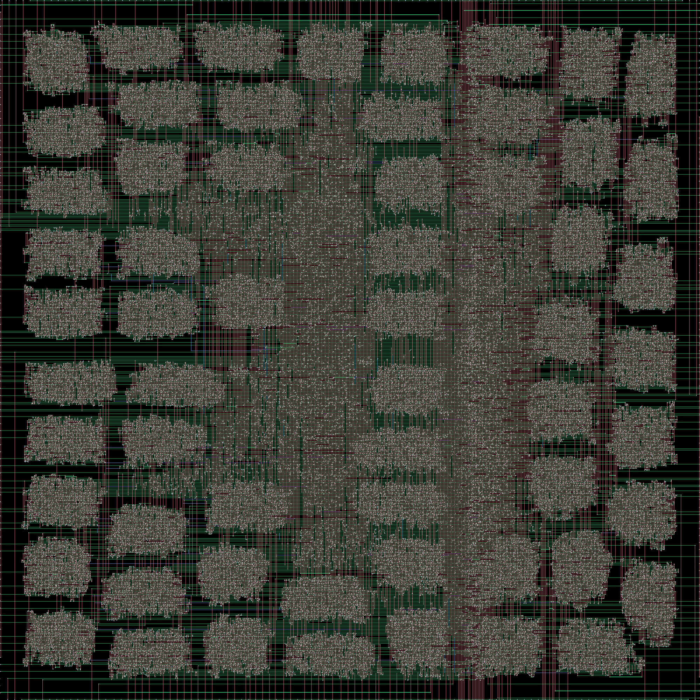
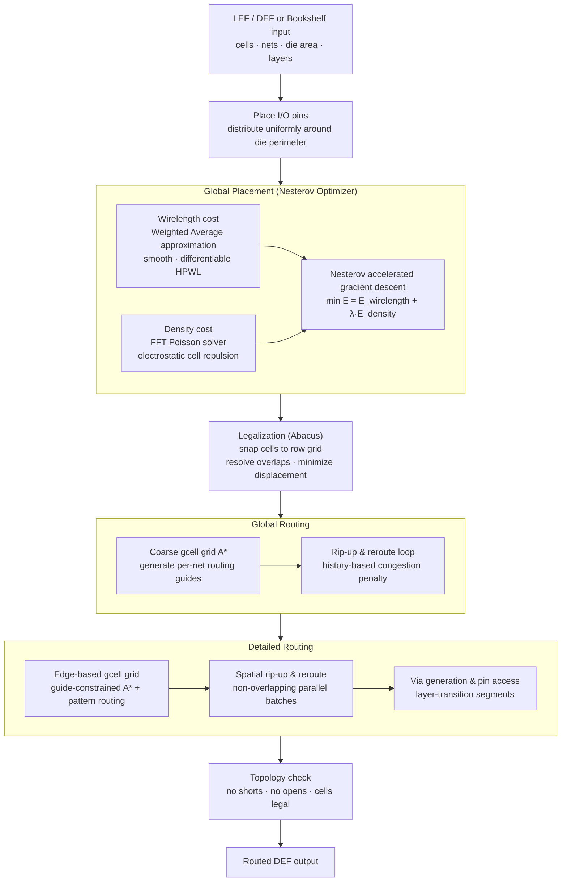

# PARE — Placement And Routing Engine

A digital IC placement and routing engine written in Rust. Implements the full physical design flow — analytical global placement, Abacus legalization, and two-stage negotiation-based routing — from scratch. It places and routes real benchmarks up to 145k cells / 143k nets, and routes pre-placed designs up to 313k cells / 407k nets, with no shorts or opens.

| IBM10 (64,227 nets) | AES (45,036 nets) |
|:---:|:---:|
|  |  |

| IBM05 (28,446 nets) | IBM01 (11,507 nets) |
|:---:|:---:|
|  |  |

*Top: IBM10 ISPD benchmark (67k cells) and AES cipher (Nangate45, 10 metal layers). Bottom: IBM05 and IBM01. All verified short-free and open-free.*

---

## Full Design Flow



---

## Placement: FFT-Accelerated Electrostatics

Global placement minimizes two competing objectives simultaneously:

**Wirelength** uses the Weighted Average (WA) smooth approximation of half-perimeter wirelength — differentiable everywhere, enabling gradient-based optimization. Per-net weights prioritize critical paths.

**Density** is modeled as an electrostatic field: cells act as electric charges that repel each other when they overlap. The density distribution is gridded into an N×N bin map, then the Poisson equation is solved in frequency domain via FFT in O(N log N) — versus O(N²) for direct methods. The resulting repulsive force gradient pushes cells out of congested regions.

**Nesterov's accelerated gradient descent** drives the iteration. Compared to vanilla gradient descent, the momentum term (aₖ = (1 + √(1 + 4aₖ₋₁²)) / 2) provides faster convergence on smooth near-convex problems like placement.

---

## Legalization: Abacus Algorithm

After global placement, cells can overlap. The Abacus algorithm legalizes them:

1. **Identify rows** — find the standard cell row height; divide die into rows, splitting at fixed macros
2. **Assign cells to rows** — by their global placement Y coordinate; overflow spills to adjacent rows
3. **Cluster within rows** — group cells into clusters and compute optimal cluster X position as a weighted centroid
4. **Pack clusters** — place sequentially along the row; adaptive padding (scales with utilization) prevents row overflow

Displacement from global placement is minimized throughout — the Abacus cost function explicitly penalizes large moves.

---

## Routing: Two-Stage Pathfinder on GCell Grid

Routing runs in two stages on an edge-based gcell grid where capacity is structurally tied to the metal layer stack. Direction is enforced by the grid itself — horizontal layers only have horizontal edge capacity, vertical layers only have vertical. Capacities are auto-computed from track pitch and gcell size.

**Global routing** operates on a coarse grid (~50×50 gcells). A* finds paths for all nets, then a Rip-up-and-Reroute loop resolves congestion. History costs accumulate on overloaded edges, steering later iterations away from hot spots (the Pathfinder algorithm).

**Detailed routing** operates on a finer gcell grid (auto-scaled to ~400×400 for large designs). Each net is first attempted with pattern routing (L-shaped and Z-shaped routes that check edge capacity), falling back to guide-constrained A* for complex paths. Spatial batching enables parallel rerouting: non-overlapping congested nets are rerouted simultaneously each iteration.

**Segment generation** converts gcell paths to physical wire segments. Pin access uses L-shaped Manhattan M1 wires with via stacks, and gcell-center routing guarantees consistent via positions across layer transitions.

---

## Verification

Post-route verification checks topology — not full design rules. It catches:

- **Shorts** — centerline intersection between segments of different nets (wires are treated as zero-width lines, so this only catches wires that literally cross, not spacing violations)
- **Opens** — BFS connectivity check that all pins on a net are reachable through the routed segments
- **Placement legality** — cells within die boundary, no cell-to-cell overlaps
- **Manhattan check** — flags any diagonal (non-Manhattan) wire segments

There is also an informational spacing check that computes bounding-box gaps between centerlines and compares against `min_spacing` from the layer definitions, but this does not account for wire widths and is not treated as an error.

**Not checked:** track alignment, minimum wire width, via design rules, end-of-line spacing, cut spacing, or any width-aware spacing. The router doesn't produce track-aligned output, so a real DRC (e.g. Calibre, KLayout DRC) would likely report violations. This verification is useful for catching routing bugs (crossed nets, unconnected pins) but should not be confused with signoff-quality DRC.

---

## Data Representation

The `NetlistDB` is the central data structure shared across all tools:

```
NetlistDB
├── cells: Vec<CellData>          # instances with dimensions, fixed flag, pin list
├── nets: Vec<NetData>            # connectivity + routed segments after routing
├── positions: Vec<Point<f64>>   # mutable cell positions (updated by placer)
├── layers: Vec<LayerData>        # metal layer stack (direction, pitch, width)
├── die_area: Rect                # chip boundary
└── tracks: Vec<TrackDef>         # routing grid definitions
```

Type-safe index newtypes (`CellId`, `NetId`, `PinId`) prevent accidental index confusion at compile time with zero runtime overhead (`repr(transparent)` u32 wrappers).

---

## Performance

| Benchmark | Flow | Cells | Nets | Utilization | Layers | Time | Peak memory | Result |
|---|---|---|---|---|---|---|---|---|
| GCD | place + route | 508 | 579 | 7% | 10 (Nangate45) | 0.4s | 0.4 GB | No shorts/opens |
| IBM01 | place + route | 12,036 | 11,507 | 49% | 6 (Bookshelf) | 17.9s | 0.7 GB | No shorts/opens |
| AES | place + route | 44,749 | 45,036 | 4% | 10 (Nangate45) | 7.0s | 0.9 GB | No shorts/opens |
| IBM05 | place + route | 28,146 | 28,446 | 49% | 6 (Bookshelf) | 109s | 2.1 GB | No shorts/opens |
| IBM10 | place + route | 66,948 | 64,227 | 49% | 6 (Bookshelf) | 187s | 10.3 GB | No shorts/opens |
| IBM13 | place + route | 81,018 | 83,806 | 49% | 6 (Bookshelf) | 308s | 13.7 GB | No shorts/opens |
| IBM14 | place + route | 145,492 | 143,202 | 49% | 6 (Bookshelf) | 460s | 28.9 GB | No shorts/opens |
| Netcard | route only | 274,700 | 290,354 | — | 10 (Nangate45) | 114s | 2.8 GB | No shorts/opens |
| Leon3mp | route only | 312,529 | 406,912 | — | 10 (Nangate45) | 32.5s | 2.4 GB | No shorts/opens |

Measured on a 28-thread machine. Utilization is movable cell area over die area; the Bookshelf dies include the gaps between rows. Netcard and Leon3mp ship already placed, so only routing runs on them. Routing keeps search state per worker thread, so its memory grows with the thread count. The routed result can differ slightly between runs because nets are routed in parallel.

All benchmarks are real circuits (ISPD or open-source RTL), not synthetic. Leon3mp is the largest, with 313k cells and 407k nets routed in 33s. IBM14 is the largest placed from scratch, with 145k cells and 143k nets. AES uses a real technology library (Nangate45) with 10 metal layers at realistic pitches.

---

## Usage

**Requirements:** Rust stable

```bash
# Route a benchmark by name (resolves to configs/route/leon3mp.toml)
cargo run --release -- route leon3mp

# Place a benchmark by name (resolves to configs/place/leon3mp.toml)
cargo run --release -- place leon3mp

# Full placement + routing flow (loads both place and route configs, merges them)
cargo run --release -- flow leon3mp

# Explicit config paths still work
cargo run --release -- route configs/route/leon3mp.toml

# Bookshelf benchmarks
cargo run --release -- flow ibm01
cargo run --release -- route ibm10
```

Output images (`nesterov_placer.png`, `placed.png`, `routed.png`) and the routed DEF are written to the `output/` directory.
