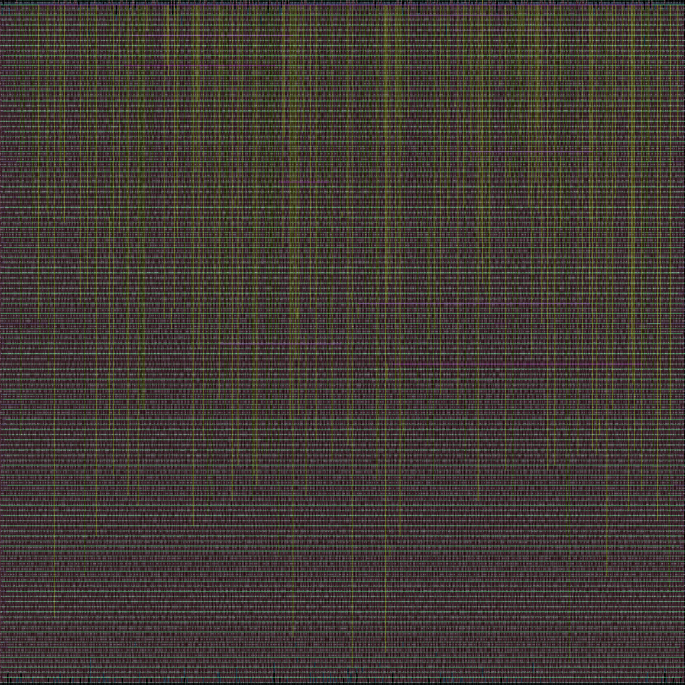
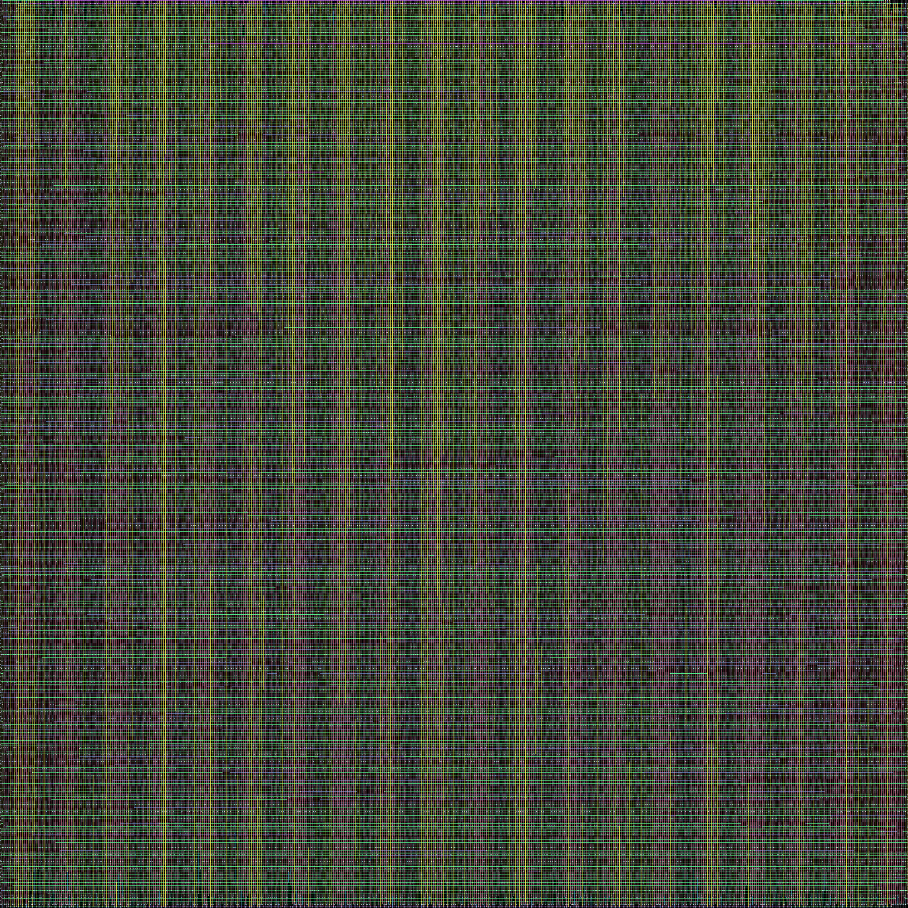
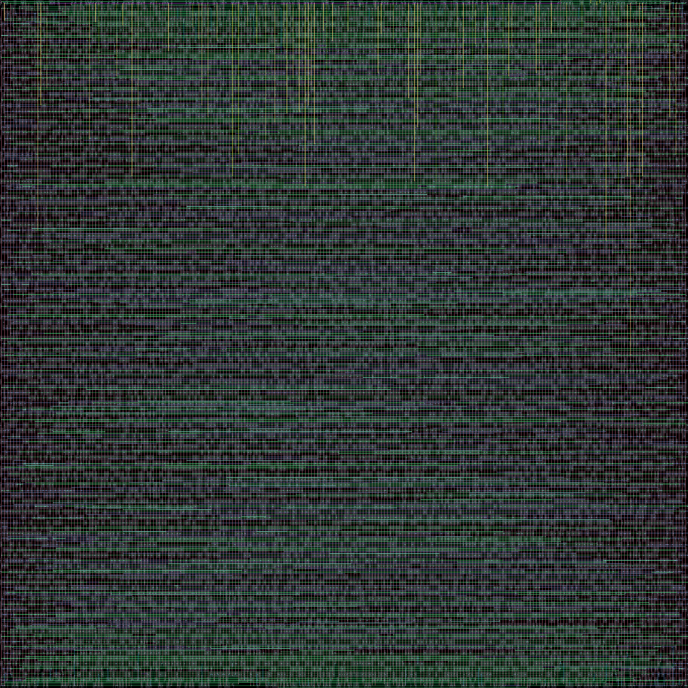
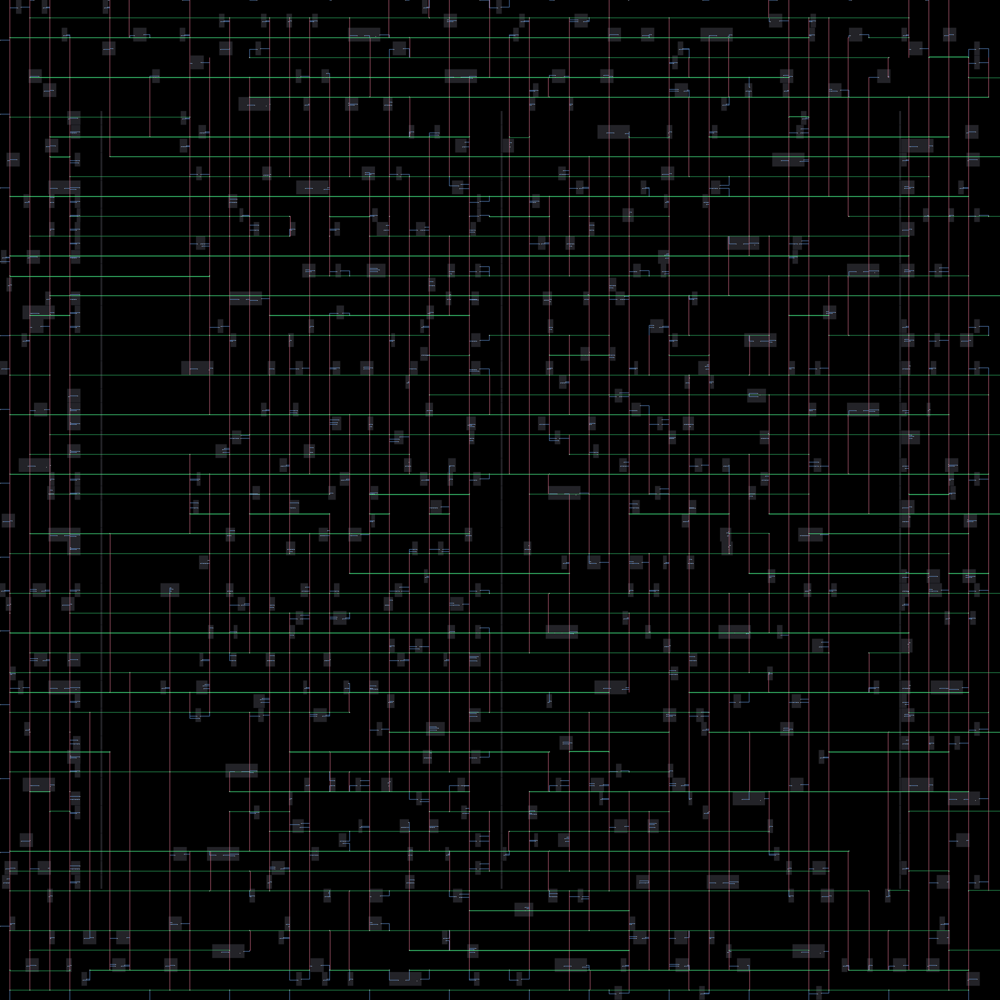
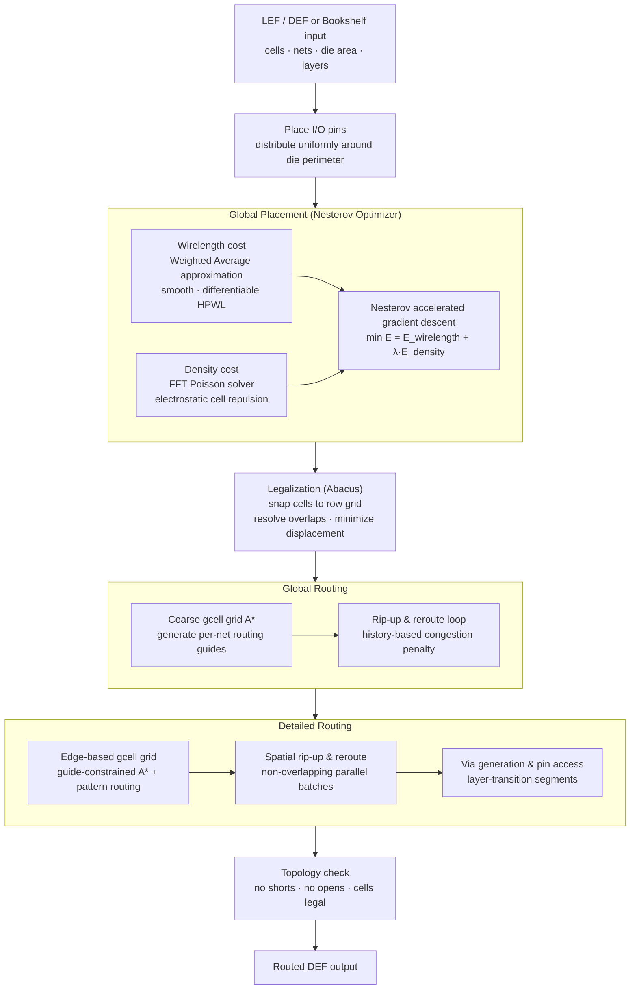

# PARE — Placement And Routing Engine

A digital IC placement and routing engine written in Rust. Implements the full physical design flow — analytical global placement, Abacus legalization, and two-stage negotiation-based routing — from scratch. It runs on real benchmarks up to 145k cells / 143k nets (place and route) and 313k cells / 407k nets (route only), but its routed output is **not yet legal**: see [Known issues](#known-issues).

| IBM10 (64,227 nets) | IBM05 (28,446 nets) |
|:---:|:---:|
|  |  |

| IBM01 (11,507 nets) | GCD (579 nets) |
|:---:|:---:|
|  |  |

*IBM ISPD benchmarks (Bookshelf) and GCD (Nangate45). These images show routing topology only; the wires contain shorts between nets (see [Known issues](#known-issues)).*

---

## Full Design Flow



---

## Placement: FFT-Accelerated Electrostatics

Global placement minimizes two competing objectives simultaneously:

**Wirelength** uses the Weighted Average (WA) smooth approximation of half-perimeter wirelength — differentiable everywhere, enabling gradient-based optimization. Per-net weights prioritize critical paths.

**Density** is modeled as an electrostatic field: cells act as electric charges that repel each other when they overlap. The density distribution is gridded into an N×N bin map, then the Poisson equation is solved in frequency domain via FFT in O(N log N) — versus O(N²) for direct methods. The resulting repulsive force gradient pushes cells out of congested regions.

**Nesterov's accelerated gradient descent** drives the iteration. Compared to vanilla gradient descent, the momentum term (aₖ = (1 + √(1 + 4aₖ₋₁²)) / 2) provides faster convergence on smooth near-convex problems like placement.

---

## Legalization: Abacus Algorithm

After global placement, cells can overlap. The Abacus algorithm legalizes them:

1. **Identify rows** — find the standard cell row height; divide die into rows, splitting at fixed macros
2. **Assign cells to rows** — by their global placement Y coordinate; overflow spills to adjacent rows
3. **Cluster within rows** — group cells into clusters and compute optimal cluster X position as a weighted centroid
4. **Pack clusters** — place sequentially along the row; adaptive padding (scales with utilization) prevents row overflow

Displacement from global placement is minimized throughout — the Abacus cost function explicitly penalizes large moves.

---

## Routing: Two-Stage Pathfinder on GCell Grid

Routing runs in two stages on an edge-based gcell grid where capacity is structurally tied to the metal layer stack. Direction is enforced by the grid itself — horizontal layers only have horizontal edge capacity, vertical layers only have vertical. Capacities are auto-computed from track pitch and gcell size.

**Global routing** operates on a coarse grid (~50×50 gcells). A* finds paths for all nets, then a Rip-up-and-Reroute loop resolves congestion. History costs accumulate on overloaded edges, steering later iterations away from hot spots (the Pathfinder algorithm).

**Detailed routing** operates on a finer gcell grid (auto-scaled to ~400×400 for large designs). Each net is first attempted with pattern routing (L-shaped and Z-shaped routes that check edge capacity), falling back to guide-constrained A* for complex paths. Spatial batching enables parallel rerouting: non-overlapping congested nets are rerouted simultaneously each iteration.

**Segment generation** converts gcell paths to physical wire segments. Pin access uses L-shaped Manhattan M1 wires with via stacks, and gcell-center routing guarantees consistent via positions across layer transitions.

---

## Verification

Post-route verification is meant to check topology — not full design rules. It currently misses most shorts (see [Known issues](#known-issues)). It is intended to catch:

- **Shorts** — centerline intersection between segments of different nets (wires are treated as zero-width lines, so this only catches wires that literally cross, not spacing violations)
- **Opens** — BFS connectivity check that all pins on a net are reachable through the routed segments
- **Placement legality** — cells within die boundary, no cell-to-cell overlaps
- **Manhattan check** — flags any diagonal (non-Manhattan) wire segments

There is also an informational spacing check that computes bounding-box gaps between centerlines and compares against `min_spacing` from the layer definitions, but this does not account for wire widths and is not treated as an error.

**Not checked:** track alignment, minimum wire width, via design rules, end-of-line spacing, cut spacing, or any width-aware spacing. The router doesn't produce track-aligned output, so a real DRC (e.g. Calibre, KLayout DRC) would likely report violations. This verification is useful for catching routing bugs (crossed nets, unconnected pins) but should not be confused with signoff-quality DRC.

---

## Data Representation

The `NetlistDB` is the central data structure shared across all tools:

```
NetlistDB
├── cells: Vec<CellData>          # instances with dimensions, fixed flag, pin list
├── nets: Vec<NetData>            # connectivity + routed segments after routing
├── positions: Vec<Point<f64>>   # mutable cell positions (updated by placer)
├── layers: Vec<LayerData>        # metal layer stack (direction, pitch, width)
├── die_area: Rect                # chip boundary
└── tracks: Vec<TrackDef>         # routing grid definitions
```

Type-safe index newtypes (`CellId`, `NetId`, `PinId`) prevent accidental index confusion at compile time with zero runtime overhead (`repr(transparent)` u32 wrappers).

---

## Known issues

Measured on the routed DEFs this tool currently produces:

| Design | Overlapping wire pairs from different nets | Nets involved | Via sites shared by different nets |
|---|---|---|---|
| GCD | 12,520 | 562 of 579 | 857 |

- **Shorts are not detected.** The shorts check rejects any pair of wires whose bounding boxes overlap by no more than a tolerance on one axis, so two parallel wires on the same track, T-junctions, and vias landing on another net's wire are never reported.
- **The router produces shorts.** Detailed routing places every wire on gcell centers, so all nets crossing a gcell edge on a layer share one centerline. Track assignment only tries the nearest track and leaves conflicting wires in place, and pin access for every net meets at the gcell center.
- **The opens check is permissive.** Wires that cross on adjacent layers count as connected without a via, and a pin counts as connected if a wire on any layer passes near it.
- **Placement is not row/site legal.** DEF rows, sites, and cell orientations are ignored; Bookshelf rows with gaps between them are filled as if contiguous.
- **The AES benchmark is invalid.** Its DEF uses sky130 cells but is paired with the Nangate45 LEF, so every cell is read as 1×1 µm. It has been removed from the results until it uses the matching library.

Runtime and memory figures will be republished once routing is legal.

---

## Usage

**Requirements:** Rust stable

```bash
# Route a benchmark by name (resolves to configs/route/leon3mp.toml)
cargo run --release -- route leon3mp

# Place a benchmark by name (resolves to configs/place/leon3mp.toml)
cargo run --release -- place leon3mp

# Full placement + routing flow (loads both place and route configs, merges them)
cargo run --release -- flow leon3mp

# Explicit config paths still work
cargo run --release -- route configs/route/leon3mp.toml

# Bookshelf benchmarks
cargo run --release -- flow ibm01
cargo run --release -- route ibm10
```

Output images (`nesterov_placer.png`, `placed.png`, `routed.png`) and the routed DEF are written to the `output/` directory.
