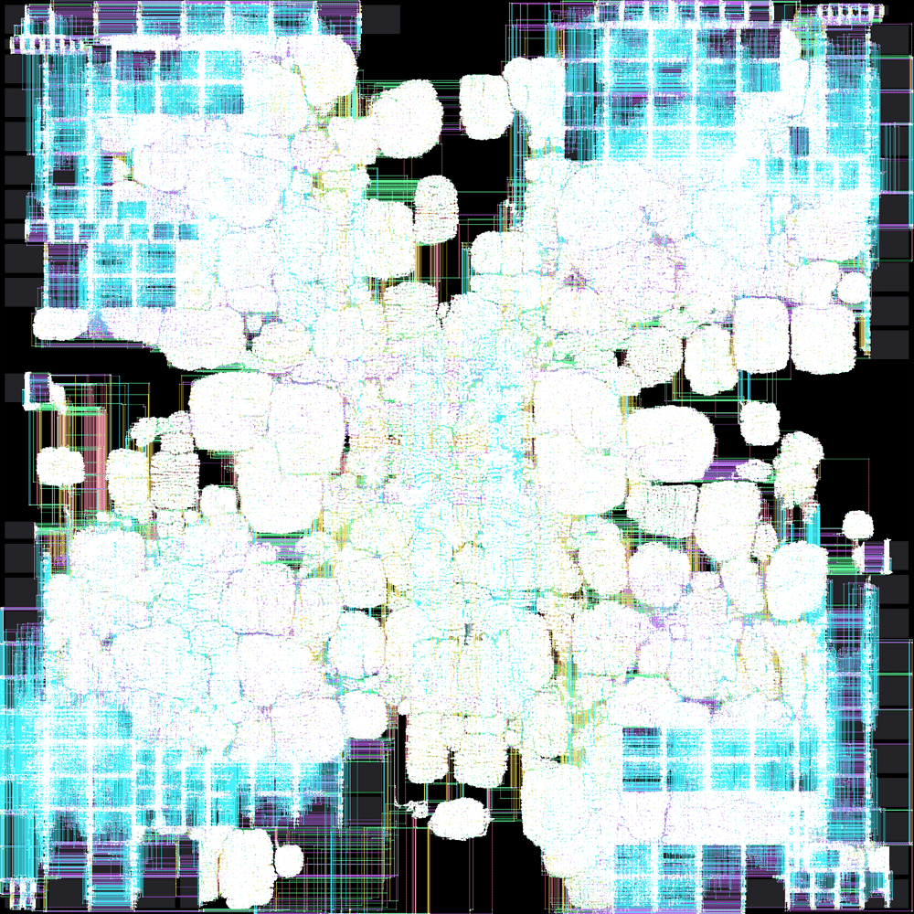

# PARE — Placement And Routing Engine

[](https://github.com/willmccallion/vlsi-physical-design/actions/workflows/ci.yml)

PARE takes a synthesized, floorplanned chip to a placed, clock-tree-synthesized, timing-repaired and routed layout. It is written from scratch in Rust, follows OpenROAD's algorithms stage by stage, and is judged by OpenROAD's own design rule checker and timer.

- Nine Nangate45 designs, from gcd to bp_quad (1.55 million cells), placed and routed with **zero violations** by OpenROAD's `check_drc`.
- From the same floorplans, PARE's whole flow ends **within 0.02 ns of OpenROAD-flow-scripts' worst slack** on aes, ibex, jpeg and ariane133, in **a third to a quarter of the time**.
- On the same placements, OpenROAD's router uses 1 to 3% less wire and 4 to 8% fewer vias, and **PARE routes 2 to 6 times faster**.

<p align="center"></p>
<p align="center">bp_quad: a BlackParrot quad-core with 220 SRAM macros on a 3.6 × 3.6 mm die, routed.</p>

## Results

Each design is placed from its floorplan and routed by `pare run <design>`; gcd's placement is part of its input. Measured at commit `92bc4dd` on an Intel Core i7-14700K (28 threads, 64 GB).

| Design | Cells | Nets | Wirelength | Vias | PARE violations | OpenROAD `check_drc` | Time | Peak memory |
|---|---:|---:|---:|---:|---:|---:|---:|---:|
| gcd | 676 | 563 | 7.3 mm | 3,074 | 0 | 0 | 1.0 s | 0.6 GiB |
| aes | 16,437 | 16,208 | 254 mm | 134,642 | 0 | 0 | 40 s | 2.3 GiB |
| ibex | 17,388 | 18,549 | 291 mm | 139,082 | 0 | 0 | 46 s | 2.6 GiB |
| jpeg | 66,229 | 73,132 | 570 mm | 402,925 | 0 | 0 | 1 min 54 s | 4.7 GiB |
| swerv | 135,119 | 130,357 | 4,864 mm | 1,072,913 | 0 | 0 | 5 min 5 s | 4.6 GiB |
| ariane133 | 180,155 | 180,890 | 6,346 mm | 1,514,641 | 0 | 0 | 9 min 56 s | 6.4 GiB |
| netcard | 274,700 | 290,334 | 9,478 mm | 2,669,001 | 0 | 0 | 1 h 3 min 49 s | 8.1 GiB |
| leon3mp | 312,529 | 406,912 | 8,511 mm | 3,325,619 | 0 | 0 | 21 min 18 s | 8.5 GiB |
| bp_quad | 1,547,804 | 1,519,244 | 51,188 mm | 11,073,959 | 0 | 0 | 1 h 33 min 22 s | 30.2 GiB |

## Against OpenROAD-flow-scripts

PARE's whole run against OpenROAD-flow-scripts' whole flow from the same floorplan, both checked by `check_drc` and timed by OpenSTA on the parasitics of the routed wires with propagated clocks.

| Design | Tool | Cells | Wirelength | Vias | PARE violations | OpenROAD `check_drc` | Slew / cap violations | WNS | TNS | Time | Peak memory |
|---|---|---:|---:|---:|---:|---:|---:|---:|---:|---:|---:|
| aes | PARE | 16,437 | 253.5 mm | 134,642 | 0 | 0 | 0 / 0 | -0.01 ns | -0.0 ns | 39 s | 2.5 GiB |
| aes | OpenROAD | 15,960 | 242.5 mm | 125,873 | 0 | 0 | 0 / 0 | -0.01 ns | -0.0 ns | 1 min 54 s | 2.6 GiB |
| ibex | PARE | 17,388 | 291.1 mm | 139,082 | 0 | 0 | 0 / 0 | -0.02 ns | -0.3 ns | 46 s | 2.7 GiB |
| ibex | OpenROAD | 17,290 | 276.9 mm | 130,664 | 0 | 0 | 0 / 0 | -0.02 ns | -0.0 ns | 2 min 15 s | 2.8 GiB |
| jpeg | PARE | 66,229 | 570.0 mm | 402,925 | 0 | 0 | 0 / 1 | -0.14 ns | -56.4 ns | 1 min 55 s | 4.8 GiB |
| jpeg | OpenROAD | 66,257 | 565.3 mm | 385,250 | 0 | 0 | 0 / 0 | -0.13 ns | -53.1 ns | 7 min 34 s | 3.7 GiB |
| ariane133 | PARE | 180,155 | 6,346.5 mm | 1,514,641 | 0 | 0 | 72 / 17 | -0.37 ns | -575.3 ns | 9 min 51 s | 6.4 GiB |
| ariane133 | OpenROAD | 180,740 | 6,748.8 mm | 1,398,910 | 0 | 0 | 72 / 6 | -0.35 ns | -563.1 ns | 34 min 53 s | 10.4 GiB |

[Results](docs/results.md) has the method, the router-only comparison, earlier measurements and the known issues.

## What it does

- **Placement:** electrostatic global placement with Nesterov's method, as OpenROAD's `gpl`, timing- and routability-driven; OpenROAD's I/O pin placement; legalization and detailed placement as OpenDP.
- **Netlist repair and timing:** a static timer modelled on OpenSTA's; slew, capacitance, fanout, setup and hold repair as OpenROAD's resizer.
- **Clock trees:** TritonCTS's H-trees, built as OpenROAD builds them.
- **Routing:** CUGR-style global routing, repair on the global routes' parasitics, then TritonRoute-style detailed routing.
- **Design rule checking:** a checker modelled on TritonRoute's FlexGC.

[How PARE works](docs/design.md) goes through every stage, where it follows OpenROAD and where it departs, and the papers behind it.

## Limits

- Only Nangate45 has been taken through the whole flow.
- No ISPD 2015, 2018 or 2019 contest design routes clean yet.
- Antenna rules are not checked.

## Quick start

`nix develop` gives the Rust toolchain and Python; `nix develop .#eda` adds OpenROAD, with its `check_drc` fixed, and the yosys the synthesized designs are made with.

```bash
python3 scripts/download.py aes                           # synthesize and floorplan aes, write its config
cargo run --release -- run aes                            # place and route it
cargo run --release -- check aes --placement output/aes/routed.def
python3 scripts/compare.py --flow aes                     # against OpenROAD-flow-scripts' whole flow
```

[Running PARE](docs/usage.md) covers the benchmark suites, every command, the configuration and the tools for looking inside a run.

## License

Licensed under either of [Apache License 2.0](LICENSE-APACHE) or [MIT](LICENSE-MIT), at your option.
