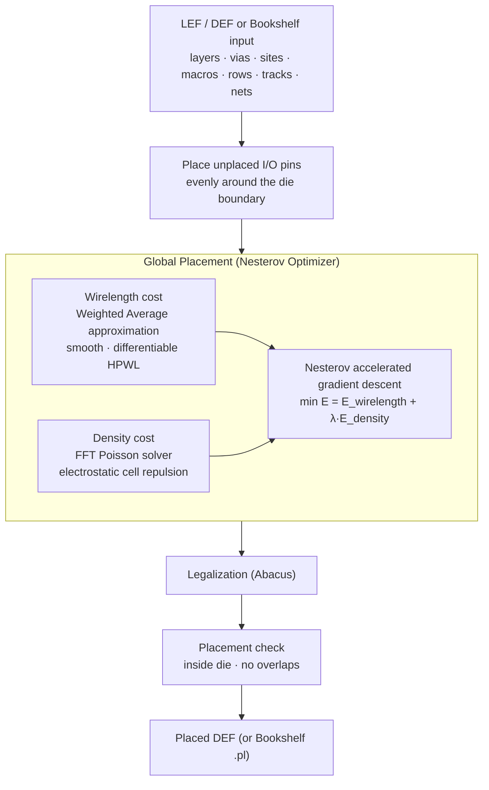

# PARE — Placement And Routing Engine

A digital IC placement and routing engine written in Rust, built from scratch: LEF/DEF and Bookshelf input, analytical global placement, and legalization. It reads real benchmarks up to 313k cells / 407k nets.

**Status:** routing is being rebuilt. The previous gcell router placed every net on gcell centers, which shorted almost every net (12,520 overlapping wire pairs between different nets on GCD alone), and its checker could not see those shorts. Both have been removed and will be replaced by global routing, track assignment and track-level detailed routing with a width-aware checker. Placement output is not yet row- and site-legal (see [Known issues](#known-issues)).

---

## Design Flow



---

## Placement: FFT-Accelerated Electrostatics

Global placement minimizes two competing objectives simultaneously:

**Wirelength** uses the Weighted Average (WA) smooth approximation of half-perimeter wirelength — differentiable everywhere, enabling gradient-based optimization. Per-net weights prioritize critical paths.

**Density** is modeled as an electrostatic field: cells act as electric charges that repel each other when they overlap. The density distribution is gridded into an N×N bin map, then the Poisson equation is solved in frequency domain via FFT in O(N log N) — versus O(N²) for direct methods. The resulting repulsive force gradient pushes cells out of congested regions.

**Nesterov's accelerated gradient descent** drives the iteration. Compared to vanilla gradient descent, the momentum term (aₖ = (1 + √(1 + 4aₖ₋₁²)) / 2) provides faster convergence on smooth near-convex problems like placement.

---

## Data Representation

All geometry is in integer database units (`Dbu`), exactly as LEF and DEF specify it. The `NetlistDB` holds the design on top of a `Library`:

```
Library                      NetlistDB
├── routing_layers           ├── die_area, rows, tracks
├── cut_layers               ├── cells     (master, location, orientation, status)
├── vias                     ├── nets      (pins, routed wires and vias)
├── sites                    ├── pins      (cell pin or I/O pin connections)
└── macros (pins, OBS)       ├── io_pins   (shapes, location, orientation)
                             └── special_nets, blockages
```

Typed indices (`CellId`, `NetId`, `PinId`, `LayerId`, `MacroId`, …) keep tables from being mixed up. Parse errors carry the file and line, and unknown macros, pins or layers are errors rather than silent defaults. The DEF writer's output reads back into an identical database and is accepted by OpenROAD.

---

## Known issues

- **No routing.** See the status note above.
- **Placement is not row/site legal.** Legalization infers rows from the die instead of using DEF rows and sites, ignores row orientation, and fills the gaps between Bookshelf rows. OpenROAD's `check_placement` reports 487 off-site cells on GCD and 18,532 on AES.
- **Placement quality is weak.** The density force ignores cell area, the step size is fixed and the wirelength smoothing is not annealed.
- **Region constraints** (DEF `REGIONS`/`GROUPS`) are not honoured.

---

## Usage

**Requirements:** Rust stable. Benchmarks are downloaded with the scripts in `scripts/` (e.g. `python3 scripts/download_gcd.py`, `python3 scripts/ibm.py 01`). `nix develop .#eda` provides OpenROAD for cross-checking results.

```bash
# Place a benchmark by name (resolves to configs/place/ibex.toml)
cargo run --release -- place ibex

# Explicit config paths also work
cargo run --release -- place configs/place/ibm01.toml
```

Images (`nesterov_placer.png` before legalization, `placed.png` after) and the placed DEF (or `placed.pl` for Bookshelf designs) are written to the output directory named in the config.
