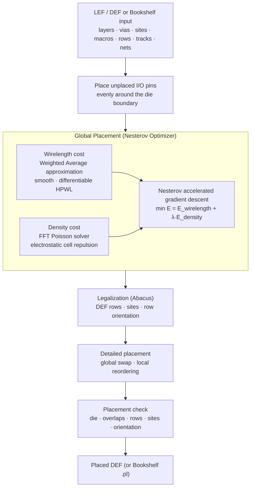

# PARE — Placement And Routing Engine

A digital IC placement and routing engine written in Rust, built from scratch: LEF/DEF and Bookshelf input, analytical global placement, and legalization. It reads real benchmarks up to 313k cells / 407k nets.

**Status:** routing is being rebuilt. The previous gcell router placed every net on gcell centers, which shorted almost every net (12,520 overlapping wire pairs between different nets on GCD alone), and its checker could not see those shorts. Both have been removed; global and track-level detailed routing are being rebuilt against a new width-aware checker. Placement is legal: OpenROAD's `check_placement` passes on every DEF benchmark.

---

## Design Flow



---

## Placement: FFT-Accelerated Electrostatics

Global placement minimizes two competing objectives simultaneously:

**Wirelength** uses the Weighted Average (WA) smooth approximation of half-perimeter wirelength — differentiable everywhere, enabling gradient-based optimization. Per-net weights prioritize critical paths.

**Density** is modeled as an electrostatic field: cells act as electric charges that repel each other when they overlap. The density distribution is gridded into an N×N bin map, then the Poisson equation is solved in frequency domain via FFT in O(N log N) — versus O(N²) for direct methods. The resulting repulsive force gradient pushes cells out of congested regions.

**Nesterov's accelerated gradient descent** drives the iteration. Compared to vanilla gradient descent, the momentum term (aₖ = (1 + √(1 + 4aₖ₋₁²)) / 2) provides faster convergence on smooth near-convex problems like placement.

---

## Data Representation

All geometry is in integer database units (`Dbu`), exactly as LEF and DEF specify it. The `NetlistDB` holds the design on top of a `Library`:

```
Library                      NetlistDB
├── routing_layers           ├── die_area, rows, tracks
├── cut_layers               ├── cells     (master, location, orientation, status)
├── vias                     ├── nets      (pins, routed wires and vias)
├── sites                    ├── pins      (cell pin or I/O pin connections)
└── macros (pins, OBS)       ├── io_pins   (shapes, location, orientation)
                             └── special_nets, blockages
```

Typed indices (`CellId`, `NetId`, `PinId`, `LayerId`, `MacroId`, …) keep tables from being mixed up. Parse errors carry the file and line, and unknown macros, pins or layers are errors rather than silent defaults. The DEF writer's output reads back into an identical database and is accepted by OpenROAD.

---

## Known issues

- **No routing.** See the status note above.
- **Global placement quality is weak.** The density force ignores cell area, the step size is fixed and the wirelength smoothing is not annealed; on IBM10, IBM13 and IBM14 it does not spread cells at all. Detailed placement recovers much of the loss on the DEF designs (HPWL −70% on AES, −79% on ibex) but cannot fix a collapsed placement.
- **Region constraints** (DEF `REGIONS`/`GROUPS`) are not honoured.

---

## Usage

**Requirements:** Rust stable and Python 3. `nix develop .#eda` provides OpenROAD for cross-checking results.

Benchmarks are downloaded by `scripts/download.py`, which also writes each design's config to `configs/<design>.toml`. Every design has a purpose, by what it was made to test: placement benchmarks are only placed, routing benchmarks (whose placement is part of the input) are only routed, and the rest are placed and then routed.

| Suite | Designs | Purpose |
|---|---|---|
| `openroad` | gcd | routing |
| `openroad` | aes, ibex (ORFS floorplans) | place and route |
| `openroad` | jpeg, swerv, netcard, leon3mp (OpenROAD placer tests) | placement |
| `ibm` | ibm01–ibm18 (Bookshelf) | placement |
| `ispd2015` | 20 `mgc_*` designs, up to 1.3M nets | place and route |
| `ispd2018`, `ispd2019` | `ispd18_test1`–`10`, `ispd19_test1`–`10` | routing |

```bash
python3 scripts/download.py --list          # every design and its purpose
python3 scripts/download.py gcd aes ibex    # designs, a suite (e.g. ispd2018), or all

cargo run --release -- run aes              # does what the design's purpose says
cargo run --release -- place aes            # placement only (refused for routing benchmarks)
cargo run --release -- route gcd            # routing only (refused for placement benchmarks)
cargo run --release -- check aes --placement output/aes/routed.def
```

Images (`nesterov_placer.png` before legalization, `placed.png` after) and the placed DEF (or `placed.pl` for Bookshelf designs) are written to the output directory named in the config.
