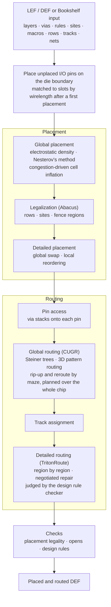

# PARE — Placement And Routing Engine

A digital IC placement and routing engine written in Rust, built from scratch. It reads LEF/DEF and Bookshelf, places cells by electrostatic spreading, legalizes and refines the placement, routes every net globally and then on the design's tracks, and checks the result against the technology's design rules with a checker modelled on OpenROAD's.

**Status:** PARE has placed and routed five Nangate45 designs, from gcd (563 nets) to leon3mp (407k nets), with zero design rule violations, judged both by its own checker and by OpenROAD's `check_drc` with a fix for one of its bugs applied (see below). Two other Nangate45 designs in that range, swerv (100k nets) and netcard (290k), are not clean yet, nor is any ISPD 2015 design. After those comes a synthesized design of more than a million cells.

## Results

Each design is placed from its floorplan and then routed by `pare run <design>`, except gcd, whose placement is part of the input. aes, ibex and jpeg are synthesized and floorplanned by OpenROAD-flow-scripts 26Q2, as its Nangate45 flow does them, at 32%, 50% and 81% utilization; leon3mp comes from OpenROAD's placer tests, at 59%. Routed DEFs are checked by OpenROAD 26Q2 `check_drc`.

| Design | Cells | Nets | PARE violations | OpenROAD `check_drc` | Time | Peak memory |
|---|---:|---:|---:|---:|---:|---:|
| gcd | 676 | 563 | 0 | 0 | 1.0 s | 0.4 GiB |
| aes | 13,108 | 12,965 | 0 | 0 | 40 s | 2.0 GiB |
| ibex | 16,876 | 18,256 | 0 | 0 | 1 min 44 s | 2.1 GiB |
| jpeg | 62,139 | 69,575 | 0 | 0 | 2 min 25 s | 4.3 GiB |
| leon3mp | 312,529 | 406,912 | 0 | 0 | 30 min 11 s | 14.4 GiB |

Measured on an Intel Core i7-14700K (28 threads) with 64 GB of memory, at commit `3dea951`. Time and memory cover the whole run, placement included.

OpenROAD's `check_drc` has a bug that reports spacing violations between two vias of one net where its wire fills the gap ([#11697](https://github.com/The-OpenROAD-Project/OpenROAD/issues/11697)). The counts above come from OpenROAD with the proposed fix ([#11698](https://github.com/The-OpenROAD-Project/OpenROAD/pull/11698)) applied, which `nix develop .#eda` builds. Unpatched OpenROAD reports 0 on gcd, aes, ibex and jpeg and 2 on leon3mp, both same-net spacing markers of that kind; [docs/openroad-check-drc-tiling.md](docs/openroad-check-drc-tiling.md) has the evidence.

<table>
  <tr>
    <td></td>
    <td></td>
  </tr>
  <tr>
    <td align="center">aes</td>
    <td align="center">ibex</td>
  </tr>
  <tr>
    <td></td>
    <td></td>
  </tr>
  <tr>
    <td align="center">jpeg</td>
    <td align="center">leon3mp</td>
  </tr>
</table>

At 32% utilization, aes's cells pack to a target density of 0.47 and gather into islands, as they do in OpenROAD's own placement of the same floorplan. Below, 10 × 10 µm of routed aes on metal1 to metal4, drawn at its true geometry by `pare view`:

<p align="center"></p>

---

## Design Flow



---

## Placement

Global placement follows ePlace and RePlAce. Cells are electric charges: the field of their density, found by solving Poisson's equation with FFTs, spreads them apart while a smooth weighted-average wirelength pulls connected cells together. Filler cells take up the whitespace, so a design that uses a small part of its die packs to the target density instead of scattering. Nesterov's method minimizes the sum, with its step predicted from the local Lipschitz constant, raising the density weight until the overflow falls below its target. With routability on, congestion is estimated as OpenROAD estimates it (RUDY), and cells in congested gcells are inflated along the way. Fence regions follow DREAMPlace 3.0: each region's cells form an electrostatic system of their own.

Abacus legalization puts cells on rows and sites with the least displacement, inside their fence regions. Detailed placement then moves cells toward the median of their nets and reorders neighbours, keeping a move only if it shortens wirelength and never onto a spot where fixed metal would block a via to one of the cell's pins.

## Routing

**Pin access.** A pin on a routing layer is reached from any track crossing on its shapes; a pin below the lowest routing layer is reached by a stack of vias, each candidate stack keeping clear of the cell's other metal.

**Global routing** follows CUGR on a 3D grid of gcells. Capacity comes from the tracks crossing each gcell edge, less what fixed metal blocks. Each net's rectilinear Steiner tree is pattern-routed with layers chosen by dynamic programming; overflowing nets are ripped up and maze-routed again, inside a corridor planned by a search over the whole chip on coarse cells so a net can detour as far as free tracks require.

**Track assignment** puts each long straight run of a global route on a track of its panel.

**Detailed routing** follows TritonRoute. A first pass routes every net region by region along its global route, then conflicts are repaired region by region: the nets in a region are ripped up and routed again by A* on the track graph, negotiating for space. Each step costs its length, plus a conflict cost per unit of length where it would short or crowd another net's wiring and a marker cost per unit of length where a violation was found lately, both rising round by round on TritonRoute's schedule. Marks go on the metal of each violation and fade as the region's nets are routed again. Whether a region's new wiring is kept is decided by the same design rule checker that judges the finished design.

## Design rule checking

The checker follows OpenROAD's (FlexGC): each net's shapes merge into polygons whose maximal rectangles and edges the rules examine. It checks shorts, metal spacing including spacing tables, end-of-line spacing, cut spacing, minimum area, width and hole, minimum cut and off-grid shapes; minimum step is reported as advisory and not counted. It checks the die in tiles so only one tile's geometry is built at a time, and violations made of fixed metal alone, which routing cannot fix, are reported apart.

---

## Data Representation

All geometry is in integer database units (`Dbu`), exactly as LEF and DEF specify it. The `NetlistDB` holds the design on top of a `Library`:

```
Library                      NetlistDB
├── routing_layers           ├── die_area, rows, tracks
├── cut_layers               ├── cells     (master, location, orientation, status)
├── vias                     ├── nets      (pins, routed wires and vias)
├── sites                    ├── pins      (cell pin or I/O pin connections)
└── macros (pins, OBS)       ├── io_pins   (shapes, location, orientation)
                             └── special_nets, blockages
```

Typed indices (`CellId`, `NetId`, `PinId`, `LayerId`, `MacroId`, …) keep tables from being mixed up. Parse errors carry the file and line, and unknown macros, pins or layers are errors rather than silent defaults. The DEF writer's output reads back into an identical database and is accepted by OpenROAD.

---

## Known issues

- **ISPD 2015 designs do not route clean yet.** On mgc_pci_bridge32_a at commit `73d6db4`, 80 repair rounds left 1,986 violations, 1,811 of them in two 10 µm gaps between macros that block every metal layer, where the wires between the die's edge and its interior crowd through.
- **swerv and netcard** have not been routed to zero violations with the current code yet.
- **Nets under a nondefault rule** are routed and checked at their own widths and spacings, while OpenROAD reads routed wires at their layers' default widths, so the two checkers disagree on such nets: on pci's clock net at commit `73d6db4`, PARE reports 135 spacing violations that OpenROAD does not, and OpenROAD one that PARE does not.

---

## Usage

**Requirements:** Rust stable and Python 3. `nix develop .#eda` provides OpenROAD, with the `check_drc` fix above, for cross-checking results, and the yosys that OpenROAD-flow-scripts 26Q2 pins; aes, ibex and jpeg are synthesized and floorplanned with them, so download those inside it.

Benchmarks are downloaded by `scripts/download.py`, which also writes each design's config to `configs/<suite>/<design>.toml`. Each design has a purpose that decides what `pare run` does with it: placement benchmarks are only placed, routing benchmarks (whose placement is part of the input) are only routed, and the rest are placed and then routed.

| Suite | Designs | Purpose |
|---|---|---|
| `openroad` | gcd | routing |
| `openroad` | aes, ibex, jpeg (synthesized and floorplanned by OpenROAD-flow-scripts) | place and route |
| `openroad` | swerv, netcard, leon3mp (OpenROAD placer tests) | place and route |
| `ibm` | ibm01–ibm18 (Bookshelf) | placement |
| `ispd2015` | 20 `mgc_*` designs, up to 1.3M nets | place and route |
| `ispd2018`, `ispd2019` | `ispd18_test1`–`10`, `ispd19_test1`–`10` | routing |

```bash
python3 scripts/download.py --list          # every design and its purpose
python3 scripts/download.py gcd aes ibex    # designs, a suite (e.g. ispd2018), or all

cargo run --release -- run aes              # does what the design's purpose says
cargo run --release -- place aes            # placement only (refused for routing benchmarks)
cargo run --release -- route gcd            # routing only (refused for placement benchmarks)
cargo run --release -- check aes --placement output/aes/routed.def
```

The placed and routed DEFs and images of each stage are written to the output directory named in the config.

### Looking inside a run

```bash
# Save the routing state after global routing, or after detailed round N, and resume from it later
cargo run --release -- route aes --placement output/aes/placed.def --save-state aes.state --save-after 20
cargo run --release -- route aes --placement output/aes/placed.def --resume aes.state

# Log every route found for some nets, or in every region meeting a box (in microns), with its cost part by part
cargo run --release -- route aes --placement output/aes/placed.def --trace-net _16807_ --trace-box 400 289 410 298

# Draw one area at its true geometry, chosen nets highlighted and violations outlined and listed
cargo run --release -- view aes --placement output/aes/routed.def --box 403 292 406.5 294.5 \
    --net _16807_ --layer metal2 --layer metal3 --out pair.png
```

---

## References

PARE is written from scratch in Rust. The methods it follows come from the papers below; where they leave details open, OpenROAD's source is the reference for its behaviour, and OpenROAD's `check_drc` is the independent judge of its results.

**Placement**

- J. Lu, P. Chen, C.-C. Chang, L. Sha, D. J.-H. Huang, C.-C. Teng and C.-K. Cheng, "ePlace: Electrostatics-Based Placement Using Fast Fourier Transform and Nesterov's Method", ACM TODAES 20(2), 2015. Electrostatic global placement.
- C.-K. Cheng, A. B. Kahng, I. Kang and L. Wang, "RePlAce: Advancing Solution Quality and Routability Validation in Global Placement", IEEE TCAD 38(9), 2019. Global placement and routability-driven cell inflation; RePlAce is OpenROAD's `gpl`.
- J. Gu, Z. Jiang, Y. Lin and D. Z. Pan, "DREAMPlace 3.0: Multi-Electrostatics Based Robust VLSI Placement with Region Constraints", ICCAD 2020. Fence regions.
- M.-K. Hsu, Y.-W. Chang and V. Balabanov, "TSV-Aware Analytical Placement for 3D IC Designs", DAC 2011. Weighted-average wirelength.
- Yu. E. Nesterov, "A method of solving a convex programming problem with convergence rate O(1/k²)", Doklady Akademii Nauk SSSR 269(3), 1983.
- P. Spindler and F. M. Johannes, "Fast and Accurate Routing Demand Estimation for Efficient Routability-driven Placement", DATE 2007. RUDY congestion estimate.
- P. Spindler, U. Schlichtmann and F. M. Johannes, "Abacus: Fast Legalization of Standard Cell Circuits with Minimal Movement", ISPD 2008.
- M. Pan, N. Viswanathan and C. Chu, "An Efficient and Effective Detailed Placement Algorithm", ICCAD 2005. Global swap and local reordering.

**Routing and checking**

- J. Liu, C.-W. Pui, F. Wang and E. F. Y. Young, "CUGR: Detailed-Routability-Driven 3D Global Routing with Probabilistic Resource Model", DAC 2020. Global routing.
- L. McMurchie and C. Ebeling, "PathFinder: A Negotiation-Based Performance-Driven Router for FPGAs", FPGA 1995. Negotiated congestion in global routing.
- A. B. Kahng, L. Wang and B. Xu, "TritonRoute: The Open-Source Detailed Router", IEEE TCAD 40(3), 2021. Detailed routing.
- A. B. Kahng, L. Wang and B. Xu, "TritonRoute-WXL: The Open-Source Router With Integrated DRC Engine", IEEE TCAD 41(4), 2022. The design rule checker (FlexGC). TritonRoute's code in OpenROAD (`src/drt`) is the reference for the repair schedule, the passes over global routes and tiles in the last rounds, and the checks.

**Tools**

- T. Ajayi et al., "Toward an Open-Source Digital Flow: First Learnings from the OpenROAD Project", DAC 2019. [OpenROAD](https://github.com/The-OpenROAD-Project/OpenROAD) 26Q2 is the reference implementation (`gpl`, `grt`, `drt`) and provides `check_drc`.
- [OpenROAD-flow-scripts](https://github.com/The-OpenROAD-Project/OpenROAD-flow-scripts) 26Q2, with [Yosys](https://github.com/YosysHQ/yosys), synthesizes and floorplans aes, ibex and jpeg, and sets the Nangate45 defaults PARE follows.

**Benchmarks and formats**

- Nangate45: the NanGate FreePDK45 Open Cell Library, as distributed with OpenROAD and OpenROAD-flow-scripts. gcd, swerv, netcard and leon3mp come from OpenROAD's test inputs.
- I. S. Bustany, D. Chinnery, J. R. Shinnerl and V. Yutsis, "ISPD 2015 Benchmarks with Fence Regions and Routing Blockages for Detailed-Routing-Driven Placement", ISPD 2015. [Contest page](https://www.ispd.cc/contests/15/ispd2015_contest.html).
- S. Mantik, G. Posser, W.-K. Chow, Y. Ding and W.-H. Liu, "ISPD 2018 Initial Detailed Routing Contest and Benchmarks", ISPD 2018.
- W.-H. Liu, S. Mantik, W.-K. Chow, Y. Ding, A. Farshidi and G. Posser, "ISPD 2019 Initial Detailed Routing Contest and Benchmark with Advanced Routing Rules", ISPD 2019.
- IBM-PLACE benchmarks in Bookshelf format, from UCLA.
- A. E. Caldwell, A. B. Kahng and I. L. Markov, "Toward CAD-IP Reuse: A Web Bookshelf of Fundamental Algorithms", IEEE Design & Test of Computers 19(3), 2002. The Bookshelf format.
- LEF/DEF 5.8 Language Reference (Si2). The LEF and DEF formats.
