# How PARE works

## Design flow

```mermaid
flowchart TD
    INPUT["LEF / DEF or Bookshelf input<br/>layers · vias · rules · sites · macros · rows · tracks · nets"]
    NL["Netlist preparation (with a Liberty library)<br/>remove the buffers synthesis left · buffer the ports"]
    IO["Place unplaced I/O pins on the die boundary<br/>matched to slots by wirelength after a first placement"]

    subgraph PL["Placement"]
        GP["Global placement<br/>electrostatic density · Nesterov's method<br/>congestion-driven cell inflation"]
        RD["Design repair<br/>slews from estimated parasitics · resize drivers · insert repeaters"]
        LEG["Legalization (OpenDP)<br/>diamond search · rip-up and replace · fence regions"]
        DP["Detailed placement (OpenDP)<br/>set matching · swaps · reordering · mirroring"]
        CTS["Clock tree synthesis (TritonCTS)<br/>sink clustering · H-tree · dummy loads · latency balancing"]
        TR["Timing repair<br/>setup · hold · on propagated clocks"]
    end

    subgraph RT["Routing"]
        PA["Pin access<br/>via stacks onto each pin"]
        GR["Global routing (CUGR)<br/>Steiner trees · 3D pattern routing<br/>rip-up and reroute by maze, planned over the whole chip"]
        GRR["Repair on global routes<br/>parasitics along the routes · design and timing repair<br/>legalization · incremental rerouting"]
        TA["Track assignment"]
        DR["Detailed routing (TritonRoute)<br/>region by region · negotiated repair<br/>judged by the design rule checker"]
    end

    CHK["Checks<br/>placement legality · opens · design rules"]
    OUT["Placed and routed DEF"]

    INPUT --> NL --> IO --> GP --> RD --> LEG --> DP --> CTS --> TR --> PA --> GR --> GRR --> TA --> DR --> CHK --> OUT
```



---

## Placement

Global placement follows ePlace and RePlAce. Cells are electric charges: the field of their density, found by solving Poisson's equation with FFTs, spreads them apart while a smooth weighted-average wirelength, smoothed over four bins as OpenROAD's `gpl` smooths it, pulls connected cells together. Cells with more than two signal pins are first scaled by their pin density, as `gpl` scales them, so that pin-heavy cells get room. Filler cells take up the whitespace, so a design that uses a small part of its die packs to the target density instead of scattering. Placement blockages keep cells out, soft ones included, as they do in `gpl`, and the OpenROAD-flow-scripts designs place at the density the flow gives them. Nesterov's method minimizes the sum, with its step predicted from the local Lipschitz constant, raising the density weight as `gpl` raises it, by a factor set from the change in half-perimeter wirelength without timing weights, until the overflow falls below its target. With routability on, congestion is estimated as OpenROAD estimates it (RUDY), each net spread over the box of one point per pin, the mean of a cell pin's shape centers or an I/O pin's center, with routing capacity held back layer by layer as the platform holds it back, and cells in congested gcells are inflated along the way. On OpenROAD's own placement of jpeg, PARE's estimate reads 0.962 where OpenROAD's reads 0.958. Fence regions follow DREAMPlace 3.0: each region's cells form an electrostatic system of their own.

I/O pins are placed in the order OpenROAD-flow-scripts places them: a first global placement without them on the netlist as synthesized, then pin placement, then the netlist repair below and placement proper. Pin placement is OpenROAD's `place_pins`: slots ring the die on every second track, clear of the corners and of the stretches macros block, the boundary is cut into sections, pins are shared out among them by the distance to their nets' cell pins, and each section's pins are matched to its slots by a minimum-cost assignment (Munkres). PARE also keeps pins off slots too close to fixed metal and widens the slot pitch where a layer's spacing asks for it. Given the placements the flow hands `place_pins` on ibex and jpeg, PARE puts all 264 and 47 pins in the slots OpenROAD 26Q2 does.

With timing constraints, placement is timing-driven as OpenROAD's is: twice along the way, as the overflow falls below 64% and then 20%, the cells are written back, the design is repaired and every net rebuffered for delay at those positions, and the worst tenth of the nets by slack get wirelength weights from 5 at the worst slack down to 1, so the next iterations pull their cells together; placement goes on with the repaired netlist, the new cells starting where the repair put them and the target density raised by the area they add, as in OpenROAD.

Legalization is OpenROAD's `detailed_placement` (OpenDP), wherever OpenROAD-flow-scripts runs it: after global placement, around timing repair at the clock tree stage and after each repair on the global routes. Every movable standard cell is placed again, the largest first and then those nearest the core's center, at the free site nearest the one its position rounds to, found by a search that widens in Manhattan distance up to 500 sites and 100 rows; a cell that finds none rips up its neighbours, takes its spot and puts them back. A site is free when it lies in a row of the cell's site, holds no other cell, suits the cell's symmetry in the row's orientation and breaks no placement rule. The members of each fence region are placed first, inside it, falling back to packing them against its corners, then refined and annealed with OpenDP's own random sequence, while other cells are kept out of it. Given OpenROAD-flow-scripts' placements before detailed placement of aes, ibex, jpeg and ariane133, and three ISPD 2015 designs with fence regions given random offsets, PARE puts every cell exactly where OpenROAD 26Q2 does, with two differences: OpenROAD reads no cell edge spacing from the ISPD 2015 LEFs, failing to parse their `LEF58_CELLEDGESPACINGTABLE`, while PARE enforces it, and when cells are ripped up OpenROAD puts them back in the order of their addresses in memory, which PARE replaces with the order of their names. Designs whose macros the placer moves are legalized with Abacus, which places the macros too, since OpenDP leaves them to a macro placer.

Detailed placement is OpenROAD-flow-scripts' `detail_place` stage: OpenDP's `improve_placement -max_displacement {5 1}`, then `optimize_mirroring`. The rows are cut into segments between fixed cells and region edges. Set matching gathers up to 25 cells of one size, no two on a net, from nearby bins and reassigns them to each other's spots by a minimum-cost matching on wirelength, solved with LEMON's network simplex as OpenROAD solves it; global and vertical swaps then move or swap each cell toward the box between the medians of its nets; windows of three neighbouring cells are tried in every order; random moves and swaps within ten sites and rows follow, twenty trials per cell a pass; and cells are flipped about their vertical axis where that shortens their nets. A change is kept only if it does not lengthen the wire, breaks no placement rule and leaves every cell within five row heights across and one row up or down of where it began. Mirroring then turns the cells with a pin on the edge of a net's box, the longest nets first, where that does not lengthen their nets. From OpenROAD's legalized placements of the seven designs above, the ISPD ones without the cell edge spacing OpenROAD fails to read, PARE puts every cell where OpenROAD 26Q2 does, a slip in OpenDP's site arithmetic that keeps it from pushing neighbours right included, except the orientations of 3 and 5 cells that mirroring turns on two of the ISPD designs: OpenROAD takes nets of equal length in the order of their addresses in memory, PARE in the design's. Designs legalized with Abacus keep PARE's own detailed placement, which moves cells toward the median of their nets and reorders neighbours, keeping a move only if it shortens wirelength and never onto a spot where fixed metal would block a via to one of the cell's pins.

## Netlist repair and timing

With a Liberty library in its config, PARE does to the netlist what OpenROAD-flow-scripts does around placement, following OpenROAD's resizer. Before placing, it removes the buffers synthesis inserted, merging each one's nets, and puts the weakest buffer after every input port and before every output port. After global placement, `repair_design` runs: every pin's slew is found as OpenSTA finds it, from a Prim-Dijkstra Steiner tree over each net carrying the signal layer's resistance and capacitance, reduced for each driver to a pi model with an Elmore delay to every load, and the Dartu-Menezes-Pileggi effective-capacitance fit against the library's delay tables. Drivers are then visited from the outputs back to the inputs: one whose slew breaks its limit takes the smallest equivalent size that meets it, and where a load's slew, a driver's capacitance or a wire's length still breaks a limit, repeaters go in along the Steiner tree, splitting wires and isolating branches as the Elmore estimate asks. Where OpenROAD's Prim-Dijkstra tree crosses itself it falls back to FLUTE, which PARE does not have, so such nets keep their Prim-Dijkstra tree. On ibex the slews this model gives agree with OpenSTA's to a median 0.01% over every driver and the loads to 0.001%. On an aes placement before any repair, PARE's `repair_design` finds 125 slew and 187 capacitance violations, resizes 88 drivers and inserts 235 buffers where OpenROAD's finds 125 and 188 and makes 88 and 236.

With an SDC file in its config, PARE times the design as OpenSTA does, with ideal or propagated clocks: the constraints are read by a small Tcl interpreter (clocks, input and output delays, uncertainty, false and multicycle paths, clock groups, derating and design limits), arrivals and required times are tagged by launching clock edge, registers are checked with the library's setup and hold tables, latches borrow time as OpenSTA's do, and the early and late sides carry separate slews and delays. On the placed aes, ibex and jpeg every endpoint's setup slack agrees with OpenSTA's to within 1.4 ps and the worst and total negative slack to the reported precision. On that analysis `repair_timing` runs after detailed placement, as the flow runs it at its clock tree stage, following OpenROAD's `RepairSetup`: the failing endpoints are taken from the worst up, and along each one's worst path the drivers with the most load delay are tried with OpenROAD's move sequence until one lands: taking a buffer out, sizing the gate up to the weakest size that is faster with its extra input load, swapping the critical input to an equivalent faster pin found by truth-table simulation, rebuffering the net, cloning the gate for half its loads, or splitting the loads behind a buffer. A pass is kept only when the worst slack improves; after the first thousand passes the repair stops once a hundred of them fix less of the initial total negative slack than a share that starts at a ten-thousandth and doubles every thousand passes; and a last gasp of sizing runs over whatever still fails. Rebuffering follows OpenROAD's `Rebuffer`: a dynamic program over the net's tree offers every buffer size at each branch and along each long wire, keeps the options that trade capacitance for slack, takes the one with the most slack at the driver and gives buffers back for area while the slack stays within a small relaxation of that best. Setup repair on the same pre-repair placements as OpenROAD's `repair_timing`, with the flow's settings, repairs aes from -0.43 ns to -0.035 ns where OpenROAD reaches -0.15 ns, ibex from -0.57 ns to -0.06 ns against -0.06 ns, and jpeg from -0.59 ns to -0.32 ns against -0.35 ns, over the first thousand iterations making the same moves iteration for iteration on aes; OpenSTA on PARE's results reads -0.04, -0.07 and -0.32 ns. After setup, hold is repaired as OpenROAD's `RepairHold` repairs it: each endpoint failing hold has buffers put in front of it, along its worst early path, of the size that adds the most hold delay for its area, where the setup slack of the loads it delays, taken as `RepairHold` takes it from the best of them, covers the delay added, and is taken out again if it leaves the design's worst setup slack lower and below the margin. The checks OpenSTA infers on gated clocks are made too: an AND or OR gate whose other input enables a clock is checked for setup against the clock's leading edge and for hold against its trailing edge. On ibex with a 0.1 ns hold uncertainty PARE repairs the six failing endpoints with the same eight buffers as OpenROAD, and at 0.3 ns with 3,206 buffers against its 3,205. With ideal clocks the four designs have no hold violations; with the clock trees below they do, and hold repair fixes them.

After detailed placement PARE builds the clock trees as OpenROAD's TritonCTS does with the flow's settings. Inverters in the clock network are first cloned at each of their loads. The clock buffers are inferred from the library, and every pattern of buffers along a few lengths of clock wire is characterized by timing it for a range of loads and input slews. The sinks are clustered under leaf buffers along a space-filling curve; the region they span is halved level by level into an H-tree whose branching points are drawn toward their sinks by capacitated k-means, its min-cost flow solved by a port of LEMON's network simplex so that ties break as they do in OpenROAD, and kept clear of macros. Each branch is built from characterized wire segments, macros get a tree of their own, the buffers' loads are evened with dummy cells, the upper half of the levels get a non-default rule of doubled spacing, long clock nets are buffered, and the trees under one clock are balanced with delay buffers. The clocks are then propagated, with the clock wire RC on the nets between clock buffers, and timing repair runs on the real skew. On the placements OpenROAD-flow-scripts hands to its clock tree stage, PARE builds the trees OpenROAD 26Q2 builds for aes, ibex, jpeg and ariane133 exactly: every buffer, dummy load, delay buffer and clock net repeater has the same name, cell, position and connections. On the flow's post-CTS placements, every endpoint's setup and hold slack with propagated clocks agrees with OpenSTA's within 0.35 ps, three jpeg endpoints aside at 2.2 ps.

After global routing, design and timing are repaired once more on the routes, as OpenROAD-flow-scripts' global route stage does. Each net's parasitics then follow its global route as OpenROAD's `estimate_parasitics -global_routing` builds them: a resistor along every straight run of the route, at its layer's resistance and capacitance per length as the platform's `set_layer_rc` gives them or else as its LEF does, a resistor through each via, and a wire from each pin to the center of the gcell where the route reaches it, climbing through the via above the pin's own layer where the route does. Given OpenROAD's own global routes and access points on aes, PARE's networks are the ones OpenROAD writes out, on all 15,621 nets, and on the networks of PARE's own routes its timing agrees with OpenSTA reading them to 0.1 ps. `repair_design` and then `repair_timing` run on these parasitics with buffering trees that follow the routes, wire by layer and via by via, as OpenROAD builds them. A net an edit changes is routed again before it is timed again, but only when one of its pins now meets the grid in another gcell, as OpenROAD's incremental global routing decides, and each resized or inserted cell is moved to a legal site as OpenDP's `legalCellPos` moves it. After each repair the placement is legalized and the nets of every cell that moved are routed again; detailed routing then follows those routes.

## Routing

**Pin access.** A pin on a routing layer is reached from any track crossing on its shapes; a pin below the lowest routing layer is reached by a stack of vias, each candidate stack keeping clear of the cell's other metal. Of a pin's candidates, those nearest the box around the rest of its net's pins come first, so that a pin is entered from the side its net leaves.

**Global routing** follows CUGR on a 3D grid of gcells. Capacity comes from the tracks crossing each gcell edge, less what fixed metal blocks. Each net's rectilinear Steiner tree is pattern-routed with layers chosen by dynamic programming; overflowing nets are ripped up and maze-routed again, inside a corridor planned by a search over the whole chip on coarse cells so a net can detour as far as free tracks require.

**Track assignment** puts each long straight run of a global route on a track of its panel.

**Detailed routing** follows TritonRoute. A first pass routes every net region by region along its global route, then conflicts are repaired region by region: the nets in a region are ripped up and routed again by A* on the track graph, negotiating for space. Each step costs its length, plus a conflict cost per unit of length where it would short or crowd another net's wiring and a marker cost per unit of length where a violation was found lately, both rising round by round on TritonRoute's schedule. Marks go on the metal of each violation and fade as the region's nets are routed again. Whether a region's new wiring is kept is decided by the same design rule checker that judges the finished design.

## Design rule checking

The checker follows OpenROAD's (FlexGC): each net's shapes merge into polygons whose maximal rectangles and edges the rules examine. It checks shorts, metal spacing including spacing tables, end-of-line spacing, cut spacing, minimum area, width and hole, minimum cut and off-grid shapes; minimum step is reported as advisory and not counted. It checks the die in tiles so only one tile's geometry is built at a time, and violations made of fixed metal alone, which routing cannot fix, are reported apart.

---

## Data Representation

All geometry is in integer database units (`Dbu`), exactly as LEF and DEF specify it. The `NetlistDB` holds the design on top of a `Library`:

```
Library                      NetlistDB
├── routing_layers           ├── die_area, rows, tracks
├── cut_layers               ├── cells     (master, location, orientation, status)
├── vias                     ├── nets      (pins, routed wires and vias)
├── sites                    ├── pins      (cell pin or I/O pin connections)
└── macros (pins, OBS)       ├── io_pins   (shapes, location, orientation)
                             └── special_nets, blockages
```

Typed indices (`CellId`, `NetId`, `PinId`, `LayerId`, `MacroId`, …) keep tables from being mixed up. Parse errors carry the file and line, and unknown macros, pins or layers are errors rather than silent defaults. The DEF writer's output reads back into the same design, a special net's rectangles listed by their shape, and is accepted by OpenROAD.

## References

PARE is written from scratch in Rust. The methods it follows come from the papers below; where they leave details open, OpenROAD's source is the reference for its behaviour, and OpenROAD's `check_drc` is the independent judge of its results.

**Placement**

- J. Lu, P. Chen, C.-C. Chang, L. Sha, D. J.-H. Huang, C.-C. Teng and C.-K. Cheng, "ePlace: Electrostatics-Based Placement Using Fast Fourier Transform and Nesterov's Method", ACM TODAES 20(2), 2015. Electrostatic global placement.
- C.-K. Cheng, A. B. Kahng, I. Kang and L. Wang, "RePlAce: Advancing Solution Quality and Routability Validation in Global Placement", IEEE TCAD 38(9), 2019. Global placement and routability-driven cell inflation; RePlAce is OpenROAD's `gpl`.
- J. Gu, Z. Jiang, Y. Lin and D. Z. Pan, "DREAMPlace 3.0: Multi-Electrostatics Based Robust VLSI Placement with Region Constraints", ICCAD 2020. Fence regions.
- M.-K. Hsu, Y.-W. Chang and V. Balabanov, "TSV-Aware Analytical Placement for 3D IC Designs", DAC 2011. Weighted-average wirelength.
- Yu. E. Nesterov, "A method of solving a convex programming problem with convergence rate O(1/k²)", Doklady Akademii Nauk SSSR 269(3), 1983.
- P. Spindler and F. M. Johannes, "Fast and Accurate Routing Demand Estimation for Efficient Routability-driven Placement", DATE 2007. RUDY congestion estimate.
- P. Spindler, U. Schlichtmann and F. M. Johannes, "Abacus: Fast Legalization of Standard Cell Circuits with Minimal Movement", ISPD 2008. Legalization of designs whose macros the placer moves.
- OpenROAD's detailed placer, OpenDP (`src/dpl`), is the reference for legalization, its diamond search, rip-up, fence region placement and placement checks, and for detailed placement: `improve_placement`'s set matching, swaps, reordering, random moves and flips, and `optimize_mirroring`.
- M. Pan, N. Viswanathan and C. Chu, "An Efficient and Effective Detailed Placement Algorithm", ICCAD 2005. Global swap and local reordering, for designs legalized with Abacus.

**Netlist repair**

- F. Dartu, N. Menezes and L. T. Pileggi, "Performance Computation for Precharacterized CMOS Gates with RC Loads", IEEE TCAD 15(5), 1996. The effective-capacitance delay calculation, as OpenSTA's `dmp_ceff_elmore`.
- C. J. Alpert, T. C. Hu, J. H. Huang, A. B. Kahng and D. Karger, "Prim-Dijkstra Tradeoffs for Improved Performance-Driven Routing Tree Design", IEEE TCAD 14(7), 1995. The Steiner trees the parasitics are estimated on, as OpenROAD's `stt`.
- L. P. P. P. van Ginneken, "Buffer placement in distributed RC-tree networks for minimal Elmore delay", ISCAS 1990. The dynamic program over a net's tree that rebuffering follows.
- OpenROAD's resizer (`src/rsz`) is the reference for `remove_buffers`, `buffer_ports`, `repair_design`, `repair_timing` and its `Rebuffer`, its placer (`src/gpl`) for the timing-driven rounds, its parasitics estimator (`src/est`) and global router (`src/grt`) for the parasitics along global routes and their incremental rerouting, OpenDP (`src/dpl`) for `legalCellPos`, and OpenSTA (`src/sta`) for the slew limits, the pi-model reduction, the delay calculation and the timing analysis PARE reproduces.

**Clock tree synthesis**

- K. Han, A. B. Kahng and J. Li, "Optimal Generalized H-Tree Topology and Buffering for High-Performance and Low-Power Clock Distribution", IEEE TCAD 39(2), 2020. The H-tree and its characterized buffering.
- B. Dezső, A. Jüttner and P. Kovács, "LEMON – an Open Source C++ Graph Template Library", Electronic Notes in Theoretical Computer Science 264(5), 2011. The network simplex the sink clustering's flows are solved with.
- OpenROAD's TritonCTS (`src/cts`) is the reference for the characterization, the clustering, the H-tree and its legalization, the macro and register trees, dummy loads and latency balancing, and its resizer for `repair_clock_inverters` and the clock net repair.

**Routing and checking**

- J. Liu, C.-W. Pui, F. Wang and E. F. Y. Young, "CUGR: Detailed-Routability-Driven 3D Global Routing with Probabilistic Resource Model", DAC 2020. Global routing.
- L. McMurchie and C. Ebeling, "PathFinder: A Negotiation-Based Performance-Driven Router for FPGAs", FPGA 1995. Negotiated congestion in global routing.
- A. B. Kahng, L. Wang and B. Xu, "TritonRoute: The Open-Source Detailed Router", IEEE TCAD 40(3), 2021. Detailed routing.
- A. B. Kahng, L. Wang and B. Xu, "TritonRoute-WXL: The Open-Source Router With Integrated DRC Engine", IEEE TCAD 41(4), 2022. The design rule checker (FlexGC). TritonRoute's code in OpenROAD (`src/drt`) is the reference for the repair schedule, the passes over global routes and tiles in the last rounds, and the checks.

**Tools**

- T. Ajayi et al., "Toward an Open-Source Digital Flow: First Learnings from the OpenROAD Project", DAC 2019. [OpenROAD](https://github.com/The-OpenROAD-Project/OpenROAD) 26Q2 is the reference implementation (`gpl`, `grt`, `drt`) and provides `check_drc`.
- [OpenROAD-flow-scripts](https://github.com/The-OpenROAD-Project/OpenROAD-flow-scripts) 26Q2, with [Yosys](https://github.com/YosysHQ/yosys), synthesizes and floorplans aes, ibex, jpeg, ariane133 and bp_quad, and sets the Nangate45 defaults PARE follows.

**Benchmarks and formats**

- Nangate45: the NanGate FreePDK45 Open Cell Library, as distributed with OpenROAD and OpenROAD-flow-scripts. gcd, swerv, netcard and leon3mp come from OpenROAD's test inputs.
- I. S. Bustany, D. Chinnery, J. R. Shinnerl and V. Yutsis, "ISPD 2015 Benchmarks with Fence Regions and Routing Blockages for Detailed-Routing-Driven Placement", ISPD 2015. [Contest page](https://www.ispd.cc/contests/15/ispd2015_contest.html).
- S. Mantik, G. Posser, W.-K. Chow, Y. Ding and W.-H. Liu, "ISPD 2018 Initial Detailed Routing Contest and Benchmarks", ISPD 2018.
- W.-H. Liu, S. Mantik, W.-K. Chow, Y. Ding, A. Farshidi and G. Posser, "ISPD 2019 Initial Detailed Routing Contest and Benchmark with Advanced Routing Rules", ISPD 2019.
- IBM-PLACE benchmarks in Bookshelf format, from UCLA.
- A. E. Caldwell, A. B. Kahng and I. L. Markov, "Toward CAD-IP Reuse: A Web Bookshelf of Fundamental Algorithms", IEEE Design & Test of Computers 19(3), 2002. The Bookshelf format.
- LEF/DEF 5.8 Language Reference (Si2). The LEF and DEF formats.
