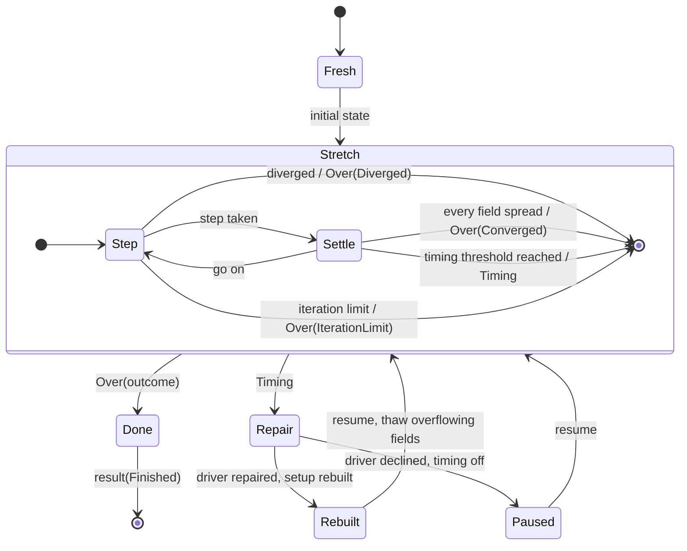
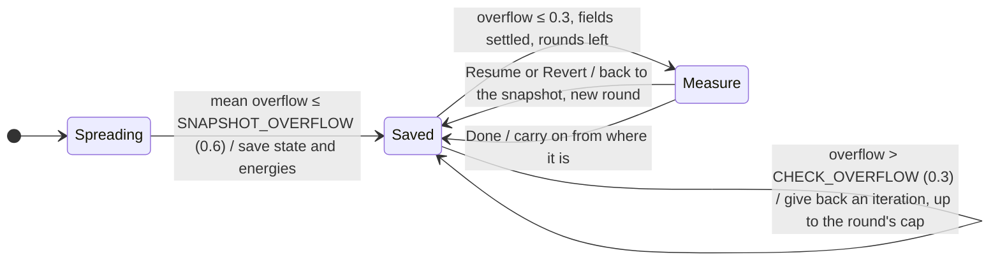

# Global placement run

`placer::global::nesterov::minimize` runs Nesterov's method in **stretches**
of iterations, with a `Run` holding what carries over between them. A
stretch ends when the run is over or when a timing-driven repair is due. A
repair can rebuild the setup the next stretch runs on. Routability-driven
placement works inside the stretches: it saves a snapshot, grows congested
cells, and goes back to the snapshot.

Each piece of the run's state is an enum, so that only the combinations the
run can reach can be written.

| State | Type | Values |
| --- | --- | --- |
| Nesterov's method between stretches | `Nesterov` | `Fresh`, `Paused(State)`, `Rebuilt(State)` |
| How a stretch ended | `StretchEnd`, then `Flow` | `Over(Outcome)` becomes `Done(Finished)`, or `Timing` |
| Routability | `Option<RoutabilityRun>` with `RoutabilityPhase` | none, `Spreading`, `Saved(Snapshot)` |
| Timing-driven placement | `Option<Vec<bool>>`, the thresholds fired | none while it is off |

## The run

While a stretch runs, the stretch holds the method's state itself, and the
run's `Nesterov` reads `Fresh`. Each stretch ends by storing `Paused`. A
rebuild carries the paused state to the new setup's objects and fields as
`Rebuilt`. On a rebuilt start, the penalty's reference wirelength is reset,
and the fields still over the target overflow move again.

## Routability within a stretch

A field has **settled** once its last iteration moved its objects by at most
`SETTLE_FRACTION` (0.6) of the most any iteration has. When rounds are left
and overflow is still above 0.3, a timing-driven repair waits for
routability to finish.

## Timing-driven placement

Each overflow in `params.timing.overflows` fires once, from the largest
down. When one fires, the stretch ends with `Timing`, and the driver
repairs the design at the objects' present positions. If the driver
declines, the fired list becomes `None`, and timing-driven placement stays
off for the rest of the run.
