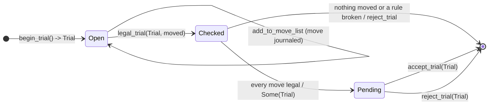
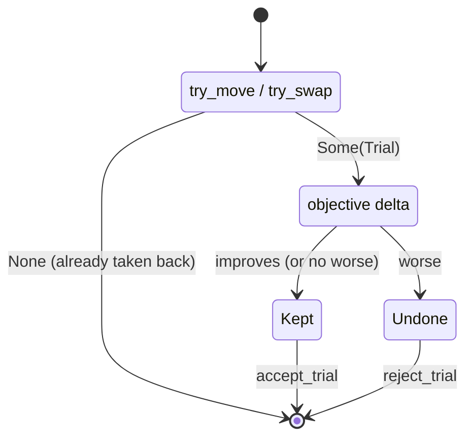

# Improver trials

Detailed improvement (`placer::legalize::opendp::improve`, OpenROAD's `dpo`)
tries moves and swaps, measures them, and keeps or takes back each one. A
**trial** is one such attempt. Its moves are journaled so that it can be
undone, as in `DetailedMgr`'s `Journal`.

A trial opens with `begin_trial`, which returns a `Trial` token. It closes
with `accept_trial`, which keeps the moves, or `reject_trial`, which undoes
them, last move first. Both take the token, so a trial is closed once, and
only after it was opened. Rust cannot force a token to be used, but `Trial`
is `#[must_use]`, and opening a trial while one is open trips a
`debug_assert`.

## One trial

`legal_trial` mirrors `DetailedMgr::verifyMove`. It hands the trial back
only when cells moved and none of them breaks a placement rule; otherwise it
rejects the trial itself.

## Who opens and who closes

`try_move` and `try_swap` (`DetailedMgr::tryMove`, `trySwap`) open a trial
and return it, still pending, when it is legal. The caller judges it by its
objective and closes it.

| Caller | Opens through | Judged by |
| --- | --- | --- |
| Random moves (`DetailedRandom`) | `try_move`, else `try_swap` | HPWL delta: kept if not worse |
| Global and vertical swaps (`DetailedGlobalSwap`, `DetailedVerticalSwap`) | `try_move`, else `try_swap` | HPWL delta: kept if not longer |
| One-site gap repair (`fixOneSiteGapViolations`) | `begin_trial` and a shift left, else a shift right | kept as soon as it is legal |

Independent set matching (`mis.rs`) does not use trials: it keeps its own
list of moves and undoes them directly.
