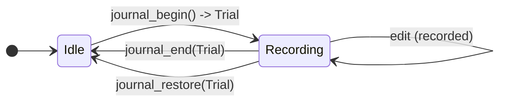
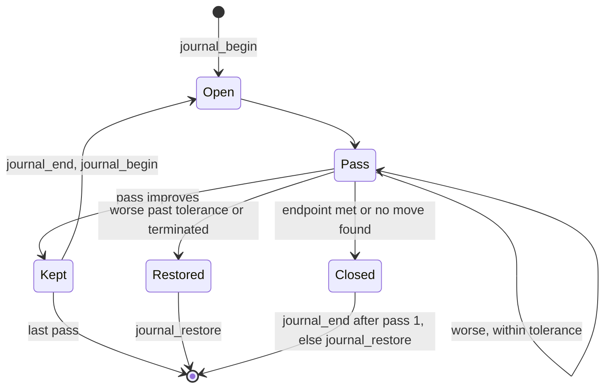
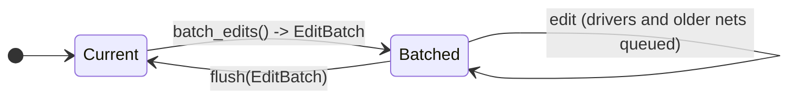
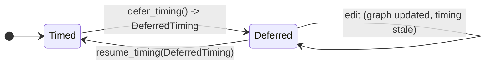

# Resizer edit modes

A `Resizer` session edits the netlist and keeps parasitics and timing up to
date as it goes. Three modes change how it does that. Each opens with a
call that returns a token and closes with a call that takes the token back,
so a mode can be closed only once, and only after it was opened. Rust cannot
force a token to be used, but each token is `#[must_use]`, and a mode opened
while it is already open trips a `debug_assert`.

| Mode | Opens with | Token | Closes with | Mirrors |
| --- | --- | --- | --- | --- |
| Trial | `journal_begin` | `Trial` | `journal_end` (keep) or `journal_restore` (undo) | `Resizer::journalBegin`/`journalEnd`/`journalRestore` |
| Edit batch | `batch_edits` | `EditBatch` | `flush` | OpenROAD marking parasitics invalid and updating them at the next query |
| Deferred timing | `defer_timing` | `DeferredTiming` | `resume_timing` | `OpenSTA` finding arrivals only when asked |

## Trial

While a trial is open, every edit is recorded. Keeping the trial drops the
record. Restoring it undoes the edits, last first, and brings timing back
to where it was.

Setup repair keeps a trial open across the passes for one endpoint. After a
pass that improves things it closes the trial and opens a new one, and it
restores the trial once a run of passes has stopped paying off.

## Edit batch

While a batch is open, parasitics and timing updates for nets that existed
before it opened wait until the flush. Nets the batch itself creates are
still estimated as they change, because the batch's own edits read them.

## Deferred timing

While timing is deferred, slews and delays are still propagated through the
graph, but the timing analysis only collects the drivers it will need to
update. Design repair reads slews and never timing, so it runs this way.

`Resizer::sta` must not be read while a batch is open or timing is
deferred, since the analysis is behind the design then; a `debug_assert`
enforces this.
