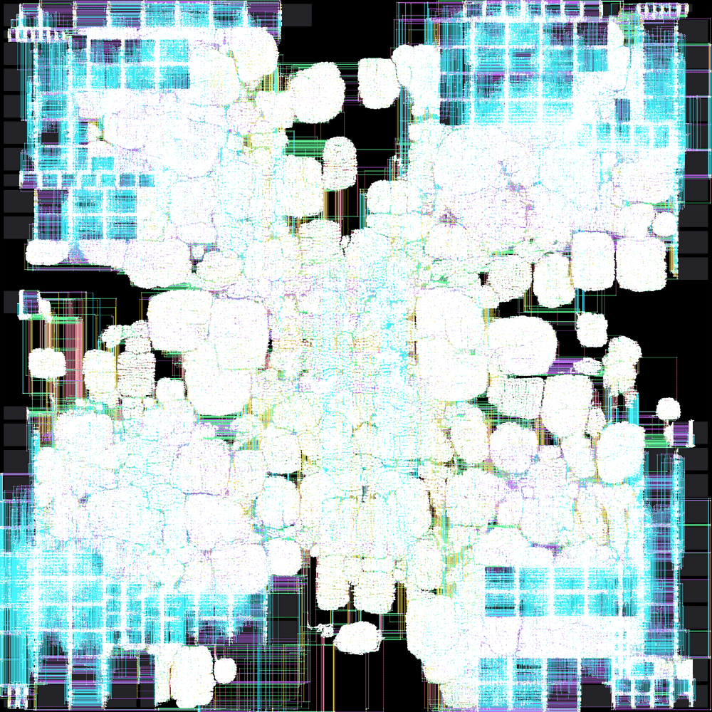
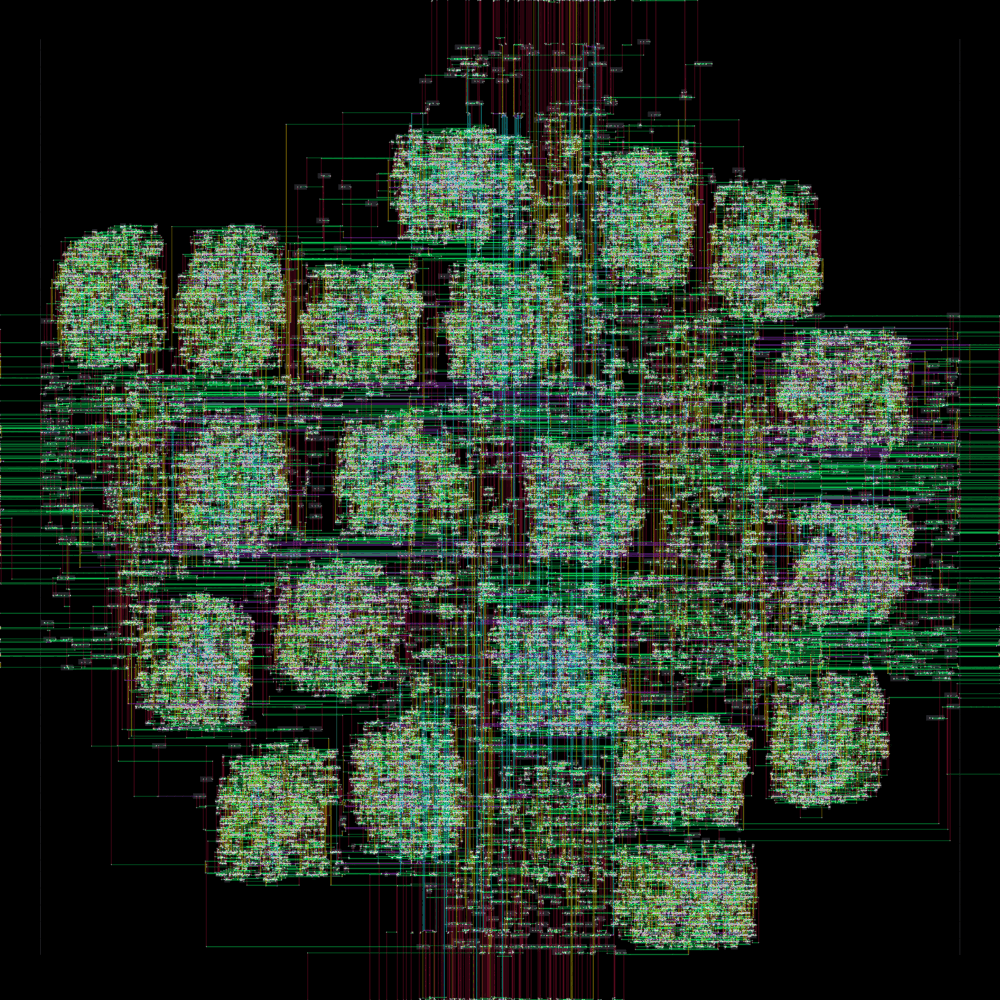
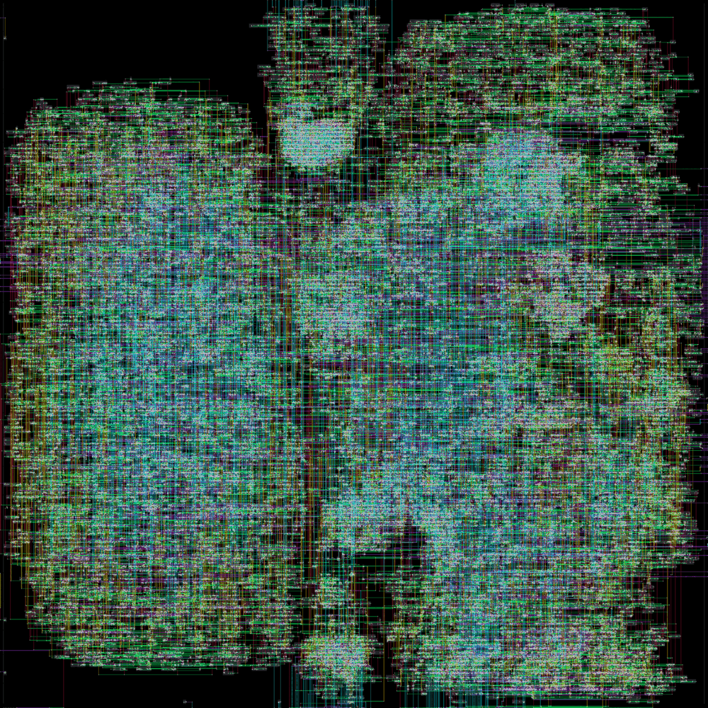
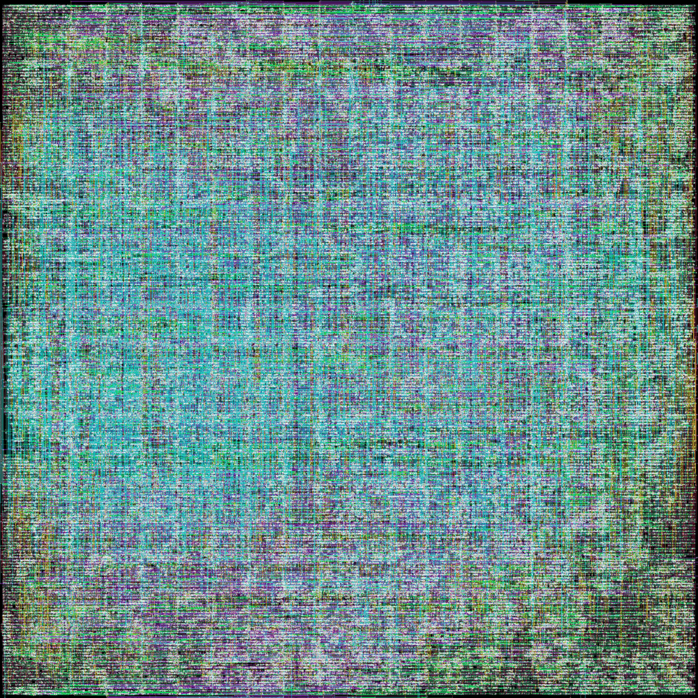
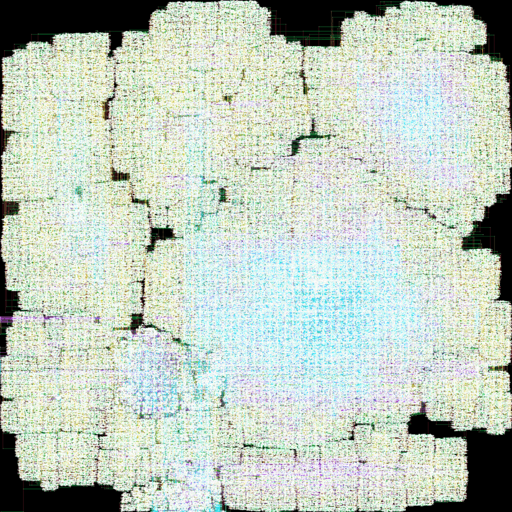
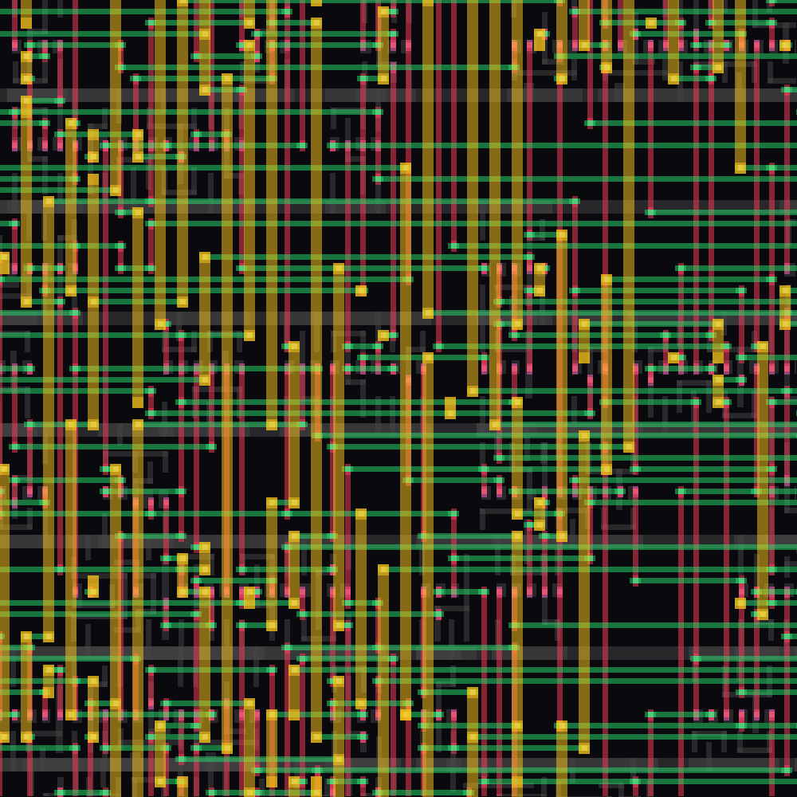

# Results

Each design is placed from its floorplan and then routed by `pare run <design>`, except gcd, whose placement is part of the input. aes, ibex and jpeg are synthesized and floorplanned by OpenROAD-flow-scripts 26Q2, as its Nangate45 flow does them, at 32%, 50% and 81% utilization; swerv, netcard and leon3mp come from OpenROAD's placer tests, at 10%, 60% and 59%. ariane133, with 132 fakeram45 SRAM macros, and bp_quad, with 220 on a 3.6 × 3.6 mm die, are synthesized and floorplanned by OpenROAD-flow-scripts 26Q2 too, at 32% and 22%. The five synthesized designs run with the netlist repair and timing work of [Netlist repair and timing](design.md#netlist-repair-and-timing), so their cell counts include the buffers it adds and leave out the ones it removes. Nets counts the signal nets with two or more pins, the ones there are to route; wirelength is the length of all their routed wires along the centreline. Routed DEFs are checked by OpenROAD 26Q2 `check_drc`.

| Design | Cells | Nets | Wirelength | Vias | PARE violations | OpenROAD `check_drc` | Time | Peak memory |
|---|---:|---:|---:|---:|---:|---:|---:|---:|
| gcd | 676 | 563 | 7.3 mm | 3,074 | 0 | 0 | 1.0 s | 0.6 GiB |
| aes | 16,437 | 16,208 | 254 mm | 134,642 | 0 | 0 | 40 s | 2.3 GiB |
| ibex | 17,388 | 18,549 | 291 mm | 139,082 | 0 | 0 | 46 s | 2.6 GiB |
| jpeg | 66,229 | 73,132 | 570 mm | 402,925 | 0 | 0 | 1 min 54 s | 4.7 GiB |
| swerv | 135,119 | 130,357 | 4,864 mm | 1,072,913 | 0 | 0 | 5 min 5 s | 4.6 GiB |
| ariane133 | 180,155 | 180,890 | 6,346 mm | 1,514,641 | 0 | 0 | 9 min 56 s | 6.4 GiB |
| netcard | 274,700 | 290,334 | 9,478 mm | 2,669,001 | 0 | 0 | 1 h 3 min 49 s | 8.1 GiB |
| leon3mp | 312,529 | 406,912 | 8,511 mm | 3,325,619 | 0 | 0 | 21 min 18 s | 8.5 GiB |
| bp_quad | 1,547,804 | 1,519,244 | 51,188 mm | 11,073,959 | 0 | 0 | 1 h 33 min 22 s | 30.2 GiB |

Measured on an Intel Core i7-14700K (28 threads) with 64 GB of memory at commit `92bc4dd`. The five synthesized designs go through netlist repair, timing-driven placement, clock trees and repair on the global routes. Time and memory cover the whole run, netlist repair and placement included.

OpenROAD's `check_drc` has a bug that reports spacing violations between two vias of one net where its wire fills the gap ([#11697](https://github.com/The-OpenROAD-Project/OpenROAD/issues/11697)). The counts above come from OpenROAD with the proposed fix ([#11698](https://github.com/The-OpenROAD-Project/OpenROAD/pull/11698)) applied, which `nix develop .#eda` builds. On the routings of commit `dc60d69`, unpatched OpenROAD reported 0 on gcd, aes, ibex and jpeg, 4 on swerv, 1 on ariane133, 3 on netcard, 1 on leon3mp and 4 on bp_quad, all spacing markers within one net like those; [docs/openroad-check-drc-tiling.md](openroad-check-drc-tiling.md) has the evidence.

bp_quad: 220 SRAM macros on a 3.6 × 3.6 mm die, routed.

<table>
  <tr>
    <td></td>
    <td></td>
  </tr>
  <tr>
    <td align="center">aes</td>
    <td align="center">ibex</td>
  </tr>
  <tr>
    <td></td>
    <td></td>
  </tr>
  <tr>
    <td align="center">jpeg</td>
    <td align="center">leon3mp</td>
  </tr>
</table>

At 32% utilization, aes's cells pack to a target density of 0.47 and gather into islands, as they do in OpenROAD's own placement of the same floorplan. Below, 10 × 10 µm of routed aes on metal1 to metal4, drawn at its true geometry by `pare view`:

---

## PARE versus OpenROAD

The fairest test of a router is another router on the same placement. `scripts/compare.py` routes each design's PARE placement twice: with PARE, and with OpenROAD 26Q2's global and detailed router set up as OpenROAD-flow-scripts sets them up for Nangate45, with its layer adjustments, routing layers, iteration counts and thread count, but without the repairs its flow runs between the two, which would change the netlist. Each result is checked by OpenROAD's `check_drc` and by PARE's checker, then timed by OpenROAD's timer with parasitics extracted from the routed wires, against the flow's clock constraint for the design. The placements are those `pare run` leaves, after its netlist repair, clock trees and setup and hold repair, so both routings come close to their clocks; the slacks compare two routings of one netlist.

| Design | Router | Wirelength | Vias | PARE violations | OpenROAD `check_drc` | WNS | TNS | Time | Peak memory |
|---|---|---:|---:|---:|---:|---:|---:|---:|---:|
| aes | PARE | 253.4 mm | 134,480 | 0 | 0 | -0.06 ns | -0.6 ns | 20 s | 2.3 GiB |
| aes | OpenROAD | 246.2 mm | 128,232 | 0 | 0 | -0.05 ns | -0.3 ns | 1 min 26 s | 2.7 GiB |
| ibex | PARE | 290.9 mm | 138,943 | 0 | 0 | -0.05 ns | -4.0 ns | 20 s | 2.6 GiB |
| ibex | OpenROAD | 284.5 mm | 132,885 | 0 | 0 | -0.02 ns | -0.4 ns | 1 min 24 s | 2.9 GiB |
| jpeg | PARE | 561.6 mm | 399,625 | 0 | 0 | -0.15 ns | -52.8 ns | 38 s | 4.8 GiB |
| jpeg | OpenROAD | 553.6 mm | 382,079 | 0 | 0 | -0.12 ns | -46.3 ns | 3 min 50 s | 3.9 GiB |
| ariane133 | PARE | 6,345.3 mm | 1,513,961 | 0 | 0 | -0.41 ns | -776.7 ns | 4 min 13 s | 6.1 GiB |
| ariane133 | OpenROAD | 6,243.5 mm | 1,399,353 | 0 | 0 | -0.39 ns | -720.2 ns | 9 min 53 s | 11.2 GiB |

PARE at commit `92bc4dd`, on the machine above; time and memory are the router's alone. WNS and TNS are the worst and total negative slack of the paths the clock constrains, with ideal clocks.

Both routers leave every design clean by both checkers. OpenROAD uses 1 to 3% less wire and 4 to 8% fewer vias; PARE is 2.3 to 6 times faster and uses less memory on three of the four designs. On the clocked paths OpenROAD's routing is slightly ahead on all four, its worst slack better by 0.01 to 0.03 ns and its total negative slack lower. Since commit `587f812` PARE's routes jog across tracks against a layer's direction, at the grid cost TritonRoute charges for it, as OpenROAD's do: the two now route about as many wrong-way segments, 21,435 to 284,744 for PARE against 21,837 to 247,464 for OpenROAD, and the via gap, 24 to 33% before, is down to 4 to 8%.

With the ports buffered, the reset nets `rst_ni` of ibex and ariane133, which once drove 1,664 and 20,618 flops straight from their input ports and dominated these comparisons, drive a single buffer each.

## Whole flows

`scripts/compare.py --flow` starts both tools from the same floorplan. PARE runs as `pare run` does: it removes the buffers synthesis inserted, buffers the ports, places timing-driven, repairs slews and loads, legalizes, builds the clock trees, repairs the setup and hold paths, routes globally, repairs slews, loads, setup and hold again on the global routes' parasitics and routes in detail. OpenROAD-flow-scripts runs its own stages as its Makefile orders them: the same buffer removal and port buffering, I/O pin placement after a first global placement, timing- and routability-driven placement, `repair_design`, legalization, clock tree synthesis with `repair_timing`, global routing with `repair_design` and `repair_timing` on its parasitics and antenna repair, and detailed routing. Both results are timed by OpenSTA with parasitics extracted from the routed wires and the clocks propagated through each flow's clock trees; slew and capacitance violations are its counts on the same parasitics.

| Design | Tool | Cells | Wirelength | Vias | PARE violations | OpenROAD `check_drc` | Slew / cap violations | WNS | TNS | Time | Peak memory |
|---|---|---:|---:|---:|---:|---:|---:|---:|---:|---:|---:|
| aes | PARE | 16,437 | 253.5 mm | 134,642 | 0 | 0 | 0 / 0 | -0.01 ns | -0.0 ns | 39 s | 2.5 GiB |
| aes | OpenROAD | 15,960 | 242.5 mm | 125,873 | 0 | 0 | 0 / 0 | -0.01 ns | -0.0 ns | 1 min 54 s | 2.6 GiB |
| ibex | PARE | 17,388 | 291.1 mm | 139,082 | 0 | 0 | 0 / 0 | -0.02 ns | -0.3 ns | 46 s | 2.7 GiB |
| ibex | OpenROAD | 17,290 | 276.9 mm | 130,664 | 0 | 0 | 0 / 0 | -0.02 ns | -0.0 ns | 2 min 15 s | 2.8 GiB |
| jpeg | PARE | 66,229 | 570.0 mm | 402,925 | 0 | 0 | 0 / 1 | -0.14 ns | -56.4 ns | 1 min 55 s | 4.8 GiB |
| jpeg | OpenROAD | 66,257 | 565.3 mm | 385,250 | 0 | 0 | 0 / 0 | -0.13 ns | -53.1 ns | 7 min 34 s | 3.7 GiB |
| ariane133 | PARE | 180,155 | 6,346.5 mm | 1,514,641 | 0 | 0 | 72 / 17 | -0.37 ns | -575.3 ns | 9 min 51 s | 6.4 GiB |
| ariane133 | OpenROAD | 180,740 | 6,748.8 mm | 1,398,910 | 0 | 0 | 72 / 6 | -0.35 ns | -563.1 ns | 34 min 53 s | 10.4 GiB |

PARE at commit `92bc4dd`. OpenROAD-flow-scripts' time is its stages from the floorplan to the routed design added up, and its memory the largest of theirs, as its own logs report them.

Both tools prepare the netlist alike: each strips 0, 1,458, 3,062 and 17,491 synthesis buffers from aes, ibex, jpeg and ariane133 and adds 387, 249, 45 and 436 port buffers, the same counts to the cell. PARE's clock trees reach 562, 1,939, 4,383 and 20,750 sinks through 106, 308, 705 and 3,385 clock buffers with 86, 219, 533 and 2,633 dummy loads; on ariane133 eight repeaters go on long clock nets, and on ibex two delay buffers balance the trees under the clock. Setup repair then takes aes from 4 failing endpoints to none, ibex from 69 to 1, jpeg from 688 to 673 and ariane133 from 3,248 to 3,136, and hold repair fixes all of the 2, 6, 84 and 105 endpoints the clock skew left failing hold, with 2, 1, 35 and 16 buffers. On the parasitics of the global routes, design repair finds nothing to do on aes, ibex and jpeg and 6 slew and 56 capacitance violations on ariane133; setup repair takes the failing endpoints from 18 to none on aes, from 248 to 59 on ibex, from 701 to 700 on jpeg and from 3,256 to 3,152 on ariane133, and hold repair adds 35, 1, 3 and 0 buffers after it. PARE's routed wire is 5%, 5% and 1% longer than the flow's on aes, ibex and jpeg and 6% shorter on ariane133, with 5 to 8% more vias; its runs take 2.9 to 3.9 times less wall time than the flow's stages, and less memory on three of the four designs.

On the routed designs PARE's worst slack is -0.01, -0.02, -0.14 and -0.37 ns against the flow's -0.01, -0.02, -0.13 and -0.35 ns, and its total negative slack -0.0, -0.3, -56.4 and -575.3 ns against -0.0, -0.0, -53.1 and -563.1 ns: within 0.02 ns of the flow on all four. Over global placement seeds 1 to 3, PARE's own timer on the global routes' parasitics puts ariane133's worst slack between -0.35 and -0.43 ns and holds those of aes, ibex and jpeg within 0.02 ns. At commit `587f812`, before the router's wrong-way jogs, the worst slacks were -0.01, -0.04, -0.15 and -0.21 ns, the totals -0.0, -0.5, -62.0 and -205.5 ns, the wire 255.9, 302.7, 569.4 and 6,409.9 mm and the vias 170,809, 181,860, 537,690 and 2,031,503, with ariane133 then 0.14 ns ahead of the flow. Before global placement grew its density weight by `gpl`'s rule and estimated congestion over the points `gpl` takes for each pin, and before setup repair's last gasp stopped where OpenROAD's does, at commit `bfd66bf`, the worst slacks were -0.01, -0.03, -0.15 and -0.34 ns, the totals -0.1, -0.2, -58.0 and -218.6 ns and the wire 255.3, 300.0, 606.0 and 6,557.3 mm. Before pins were entered from the side their nets leave, at commits `1d0606e` and `ca1aa3c`, the worst slacks were -0.01, -0.03, -0.16 and -0.25 ns, the totals 0.0, -0.2, -58.7 and -274.8 ns and the wire 258.4, 304.9, 619.6 and 6,612.6 mm. Before the global placement and I/O pin work of [Placement](design.md#placement), at commit `56b7ebd`, the worst slacks were -0.02, -0.04, -0.19 and -0.26 ns, the totals -0.1, -2.9, -79.0 and -270.4 ns and the wire 274.7, 318.4, 660.2 and 6,399.3 mm, with ariane133 placed at a density of 0.40 rather than the 0.30 the flow gives it. With OpenDP's legalization but PARE's own detailed placement, at commit `da7a637`, the worst slacks were -0.01, -0.06, -0.16 and -0.28 ns, the totals 0.0, -1.6, -67.9 and -333.4 ns and the wire 268.1, 315.5, 655.8 and 6,372.7 mm; with Abacus legalization, at commit `2457308`, the worst slacks were -0.03, -0.05, -0.15 and -0.29 ns, the totals -0.1, -0.5, -62.9 and -369.2 ns and jpeg's wire 609.3 mm. Known issues breaks down the wire PARE still adds over the flow. Before the repair on global routes, at commit `136de1c`, the worst slacks were -0.03, -0.10, -0.24 and -0.31 ns and the totals -0.4, -17.5, -106.7 and -408.8 ns; with ideal clocks and no tree, at commit `3c12a9f`, the worst slacks were -0.03, -0.08, -0.22 and -0.27 ns. The capacitance violations left on PARE's side are drivers clean on the global routes' estimate that detailed routing then changed, and the 72 slew violations on ariane133 are in the flow's result too.

Before any of the netlist work, at commit `06cc695`, the same flows gave:

| Design | Tool | Cells | Wirelength | Vias | PARE violations | OpenROAD `check_drc` | WNS | TNS | Time | Peak memory |
|---|---|---:|---:|---:|---:|---:|---:|---:|---:|---:|
| aes | PARE | 13,108 | 227.2 mm | 150,724 | 0 | 0 | -2.19 ns | -395.7 ns | 34 s | 1.9 GiB |
| aes | OpenROAD | 15,960 | 242.5 mm | 125,873 | 0 | 0 | 0.00 ns | 0.0 ns | 1 min 54 s | 2.6 GiB |
| ibex | PARE | 16,876 | 374.9 mm | 188,822 | 0 | 0 | -0.82 ns | -679.1 ns | 36 s | 2.1 GiB |
| ibex | OpenROAD | 17,290 | 276.9 mm | 130,664 | 0 | 0 | 0.00 ns | 0.0 ns | 2 min 15 s | 2.8 GiB |
| jpeg | PARE | 62,139 | 1,036.4 mm | 578,571 | 0 | 0 | -1.24 ns | -691.9 ns | 2 min | 4.2 GiB |
| jpeg | OpenROAD | 66,257 | 565.3 mm | 385,250 | 0 | 0 | -0.12 ns | -45.8 ns | 7 min 34 s | 3.7 GiB |
| ariane133 | PARE | 175,699 | 7,504.2 mm | 2,109,089 | 0 | 0 | -1.20 ns | -2,593.2 ns | 12 min 8 s | 6.4 GiB |
| ariane133 | OpenROAD | 180,740 | 6,748.8 mm | 1,398,910 | 0 | 0 | -0.37 ns | -668.1 ns | 34 min 53 s | 10.4 GiB |

PARE at commit `06cc695`, ibex at `6370079`. OpenROAD-flow-scripts' time is its stages from the floorplan to the routed design added up, and its memory the largest of theirs, as its own logs report them; with propagated clocks, its own final report gives WNS of -0.01, -0.02, -0.13 and -0.66 ns.

The flow stripped 0, 1,458, 3,062 and 17,491 synthesis buffers from aes, ibex, jpeg and ariane133 before placing, and added 2,852, 1,872, 7,180 and 22,532 cells over its stages where the placement called for them. Where synthesis had buffered heavily, the netlist it places is far shorter to begin with: OpenROAD's own global placement of jpeg's netlist as synthesized, without I/O pins, has 735.6k µm of half-perimeter wirelength and PARE's 742.7k, on ibex 247.4k and 246.5k, while the flow's placement after stripping has 425.6k on jpeg and 209.2k on ibex. On aes, where nothing was stripped, PARE's run ends with 6% less wire than the flow's result and 20% more vias; on jpeg the flow's result has 45% less wire. Over the four designs the flow's result has 16 to 34% fewer vias, and PARE is 2.9 to 3.8 times faster and, on three of the four, uses less memory. What PARE lacked then was the netlist work, not the geometry: buffering, resizing and a clock tree.

## Known issues

**ISPD 2015 designs do not route clean yet.** On mgc_pci_bridge32_a at commit `73d6db4`, 80 repair rounds left 1,986 violations, 1,811 of them in two 10 µm gaps between macros that block every metal layer, where the wires between the die's edge and its interior crowd through.
- **ISPD 2018 and 2019 designs do not route clean yet.** They load, and ISPD 2018's rules are the ones the checker enforces, but no design of either suite has been taken to a clean result; ISPD 2019's corner spacing and cut enclosure rules are parsed and not enforced.
- **Clock tree insertion delays are not read.** Liberty's clock tree path tables, which give a macro's internal clock latency, are not parsed, so no sink gets insertion delay; none of the measured libraries has them.
- **Timing-driven placement needs the default RUDY estimate.** It changes the netlist as it goes, which the global-router congestion estimate cannot follow.
- **Some drivers still break their capacitance limit after routing**: 0, 0, 1 and 17 on aes, ibex, jpeg and ariane133 by OpenSTA's count on the extracted parasitics, where the repair's estimate on the global routes was within the limit; the 72 slew violations on ariane133 are in OpenROAD-flow-scripts' result too.
- **Routed wire is longer than OpenROAD's, on jpeg from the router and on ibex from placement.** At commit `587f812`, measured by OpenROAD on both finished DEFs, jpeg's half-perimeter wire is 501,953 µm against OpenROAD-flow-scripts' 511,158 µm, 2% less, but its routes run 13% over that against OpenROAD's 11%, ending at 569.4 mm against 565.3 mm. Routing the flow's own placement at commit `bfd66bf`, PARE came to 579.0 mm: two-pin nets match OpenROAD's 190.1 mm and nets of more pins run 3 to 4% longer. aes and ibex carry 2% and 7% more half-perimeter wire, 204,488 µm against 200,011 µm and 242,719 µm against 226,697 µm. On ibex about 7 mm of the gap comes from the first global placement, which leads to other pin slots than the flow's: before pins were entered from the side their nets leave, the flow's pins took the routed wire from 304.9 to 297.6 mm.
- **Antenna rules are not checked.** PARE skips the LEF's antenna statements; OpenROAD-flow-scripts checks the global routes for antenna violations and repairs them with diodes (it finds none on ibex).
- **Very high fanout nets** come out longer and with more vias than OpenROAD routes them: at commit `06cc695`, on the netlist as synthesized, ariane133's reset, an input port driving 20,618 flops, took 16% more wire and 33% more vias in PARE's routing and was slower to its farthest flop. With the ports buffered, the measured designs no longer have such a net.
- **Nets under a nondefault rule** are routed at their own widths and spacings and checked both that way and as OpenROAD reads routed wires, at their layers' default widths, where narrower wire can break end-of-line, same-net spacing and shape rules. The router does not yet keep to that second reading. On pci's clock net at commit `73d6db4`, before the second check, PARE reported 135 spacing violations that OpenROAD did not, and OpenROAD one same-net spacing violation, seen only at the default width, that PARE did not; not measured since.
